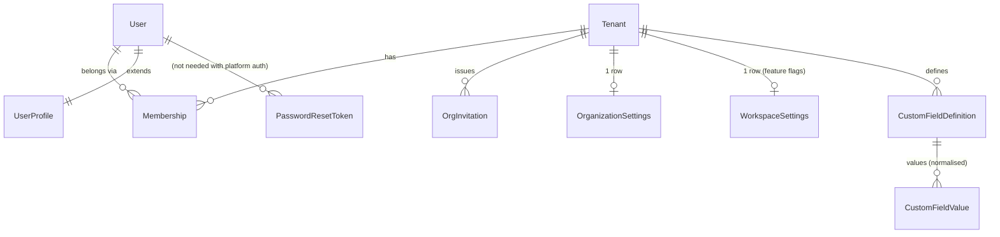
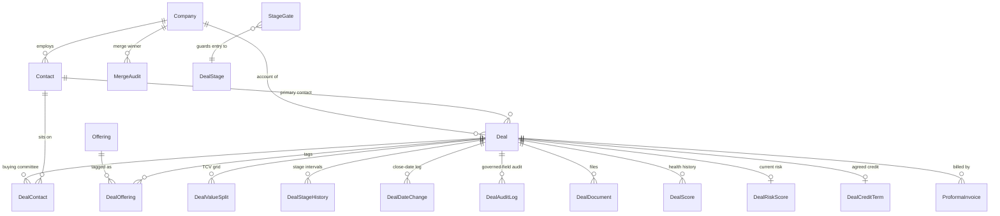
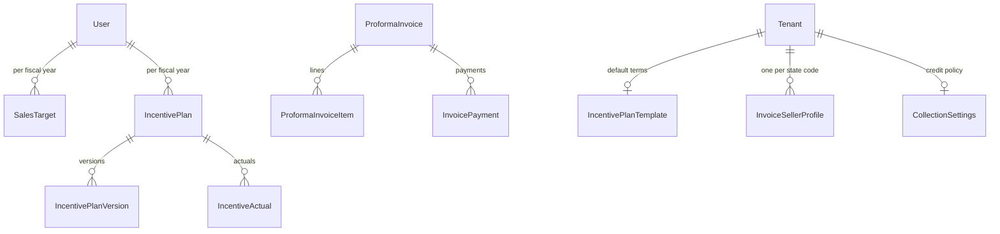
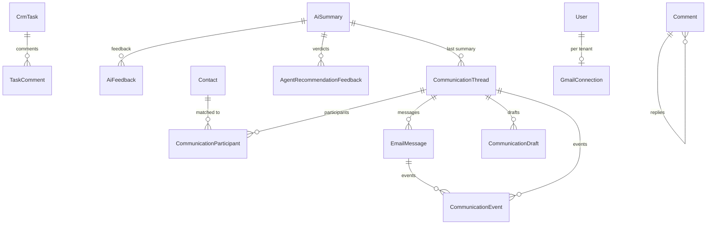

# Salenix CRM — Database BRD & OutSystems Data Model Specification

| | |
|---|---|
| **Document** | Database Business Requirements & Data Model Specification |
| **Product** | Salenix (internal name *Saleinx* / repo `multi-tenant-crm`) |
| **Purpose** | Rebuild the Salenix database as an OutSystems data model (entities, static entities, relationships, indexes, and the database logic that must move into OutSystems server actions) |
| **Source system** | PostgreSQL (Supabase) · Drizzle ORM · 70 hand-written SQL migrations (`drizzle/0000` → `drizzle/0070`) |
| **Companion document** | `Salenix-BRD-Application-Logic.md` (screens, roles, processes, business rules, calculations, jobs, integrations) |
| **Version** | 1.0 — generated from source on 2026-11-10 |

---

## Table of contents

1. [Purpose and scope](#1-purpose-and-scope)
2. [Source database at a glance](#2-source-database-at-a-glance)
3. [Key design decisions for OutSystems](#3-key-design-decisions-for-outsystems)
4. [Module and domain map](#4-module-and-domain-map)
5. [Modelling conventions](#5-modelling-conventions)
6. [Entity relationship diagrams](#6-entity-relationship-diagrams)
7. [Static entities (enumerations)](#7-static-entities-enumerations)
8. [Entity specifications (all 66 tables)](#8-entity-specifications)
9. [Database logic that must be rebuilt as server actions](#9-database-logic-that-must-be-rebuilt-as-server-actions)
10. [Features with no native OutSystems equivalent](#10-features-with-no-native-outsystems-equivalent)
11. [Data migration plan](#11-data-migration-plan)
12. [Acceptance checklist](#12-acceptance-checklist)

---

## 1. Purpose and scope

Salenix is a multi-tenant B2B sales CRM: companies, contacts, a governed deal pipeline, targets and incentives, proforma invoicing and collections, communications (email + Gmail sync), AI insights and an Ask Mira integration.

This document specifies **everything stored in the database** and how to reproduce it in OutSystems:

- every table, column, type, default, nullability, foreign key and index, mapped to an OutSystems entity/attribute;
- every enumeration and CHECK-constrained value list, mapped to a static entity;
- every piece of logic that lives *inside* Postgres today (triggers, functions, the rollup view, row-level security, check constraints, partial unique indexes) and the server action that must replace it;
- the order and transformations for migrating existing data.

Out of scope here (covered in the application-logic document): screens, UI behaviour, role matrix, calculations that live in application code, background jobs and integrations.

> **Platform note.** OutSystems 11 (O11) runs on SQL Server/Oracle; OutSystems Developer Cloud (ODC) runs on PostgreSQL (Aurora). Neither exposes database triggers, row-level security, custom functions or extensions to the developer. Everything in §9 and §10 must therefore become explicit OutSystems logic regardless of which platform you choose. Where O11 and ODC differ, it is called out.

---

## 2. Source database at a glance

| Item | Count / detail |
|---|---|
| Tables | **66** (in 60 schema files under `src/db/schema/`) |
| Views | 1 — `company_rollups` (security-invoker) |
| Postgres enums | 14 |
| Extra value lists enforced by CHECK constraints or code | ~30 (become static entities) |
| Triggers | 5 on `deals`/`deal_audit_log` (+ append-only guards) |
| Functions | `app_set_ctx`, `deal_stage_rank`, `deal_stage_history_sync`, `deal_close_date_pushback_sync`, `deal_governance_sync`, `deal_audit_log_immutable` |
| Extensions | `vector` (pgvector, 1536-dim embeddings, HNSW index), `pg_trgm` (trigram similarity for duplicate detection), `pgcrypto`/`gen_random_uuid()` |
| Row-level security | 121 policies on ~40 tables, keyed on `app.tenant_id`; FORCE RLS; fails closed |
| Money | Integer **minor units** (`bigint`, paise/cents) everywhere except incentives (exact decimals in ₹ Lakh / ₹ Crore) |
| Primary keys | `uuid` (`gen_random_uuid()`), except `users.id` (text, `user_…` / `usr_…`) and a few composite keys |
| Multi-tenancy | Every business table has `tenant_id uuid NOT NULL → tenants(id) ON DELETE CASCADE` |

### 2.1 Cross-cutting column patterns

| Pattern | Columns | Tables |
|---|---|---|
| Tenant scope | `tenant_id` | all except `users`, `password_reset_tokens`, `askmira_used_tokens` |
| Timestamps | `created_at`, `updated_at` (`now()`; app bumps `updated_at` on update) | almost all |
| Soft delete | `deleted_at`, `deleted_by` | companies, contacts, deals, tasks, notes, comments, communication_drafts (`deleted_at` only) |
| Last editor | `updated_by` | companies, contacts, deals, organization_settings, invoice_seller_profiles, sales_targets, incentive tables, collection_settings, communication_threads |
| Polymorphic link | `entity_type` + `entity_id` | tasks, notes, comments, notifications, activity_logs, email_messages, email_drafts, communication_threads, communication_drafts, embeddings, ai_summaries, agent_*, relationship_signals |
| Dedup | `normalized_name`, `merged_into_id`, `dedup_override` | companies, contacts |
| Custom fields | `custom_fields jsonb` (keyed by definition `key`) | deals, companies, contacts |

---

## 3. Key design decisions for OutSystems

These decisions shape the whole model. Each has a recommendation and the reason for it.

### 3.1 Identifiers — use AutoNumber Long Integer Ids, keep the UUID for migration

- **Recommendation:** every entity uses the OutSystems default `Id` (Long Integer, AutoNumber). Add `LegacyUuid` (Text 36, unique index) on every migrated entity.
- **Why:** native Identifier types give typed foreign keys, faster joins and smaller indexes, and work cleanly in Aggregates. The UUID column lets the migration map old FKs to new Ids and lets external systems (Ask Mira) be re-linked.
- **Alternative:** keep Text(36) GUID ids (`Is AutoNumber = No`, generated with `GenerateGuid()`). Choose this only if external systems must keep the exact same ids after cutover.

### 3.2 Users and authentication — use the platform User entity

- Salenix stores its own `users` table with **scrypt** password hashes and issues a 7-day HS256 JWT cookie.
- **Recommendation:** use the OutSystems **User** system entity (and Users/Reactive login, or an external IdP via SAML/OIDC) for login, password policy and sessions. Create `UserProfile` as a 1:1 extension (`Id = User Identifier`) holding `FirstName`, `LastName`, `ImageUrl`, `EmailVerified`, `LegacyUserId`.
- Every source column that holds a user id as text without an FK (`owner_id`, `created_by`, `actor_user_id`, `approved_by` …) becomes a **User Identifier** attribute.
- **Passwords cannot be migrated** (scrypt is not an OutSystems hash format). Plan a forced password-reset email at cutover. `password_reset_tokens` is then not needed.
- The special value `'system'` (used as actor for cron jobs and webhooks) has no user row. Model it as **NULL User + `IsSystem` Boolean**, or create one technical "System" user and point all system actions to it (recommended — keeps reports simple).

### 3.3 Multi-tenancy — explicit TenantId, do **not** use O11 built-in multi-tenancy

- In Salenix one person can belong to **several workspaces** and switch between them (`select-org`). O11's built-in multi-tenancy binds each User to exactly one tenant, so it cannot express this.
- **Recommendation:**
  - Keep a `Tenant` entity and a `Membership` entity (TenantId, UserId, Role, Status).
  - Keep `TenantId` (Tenant Identifier, mandatory, indexed) on every business entity.
  - Store the active tenant in a session variable (`Session.ActiveTenantId`, O11) or a client variable + server re-validation (Reactive/ODC). **Always re-check the membership on the server** — never trust the client value.
  - **Every** Aggregate and SQL query filters `TenantId = GetActiveTenantId()`. Enforce this by only exposing data through Core Service "Get/List" server actions (never expose entities as Public with write access), and add a code-review checklist item (see §12).
- This replaces Postgres RLS (§9.6). It fails *open* if a developer forgets the filter, which RLS did not — hence the service-layer rule.

### 3.4 Money — keep integer minor units

- Keep `…Minor` attributes as **Long Integer** holding paise/cents. Convert only at the UI boundary: `Major = Minor / 10^decimals` where decimals = 2 for every currency except JPY (0).
- **Why:** all formulas (GST split, quota weight, value split remainders, collections) are written in integer arithmetic with explicit rounding. Switching to the OutSystems `Currency` type (Decimal 37,8) would change rounding results and break reconciliation with migrated data.
- Incentive figures are **Decimal** with the exact source precision (₹ Lakh `14,5`, ₹ Crore `16,7`, fractions `9,6`).

### 3.5 Enumerations — static entities

- All 14 Postgres enums and all CHECK/code-defined value lists become **Static Entities** with an `Id` (Text code, e.g. `"proposal"`) plus `Label`, `Order`, `IsActive`, and domain attributes (e.g. `FunnelRank`, `DefaultProbability`). Using the source code as the static entity identifier keeps migration a straight copy. See §7.

### 3.6 Soft delete

- Keep `DeletedAt` / `DeletedBy`. Every list/get server action adds `DeletedAt = NullDate()` unless the caller is the *Recently deleted* screen. This replaces the RLS `include_deleted` switch.
- Merged companies/contacts (`MergedIntoId` not null) must be excluded the same way.

### 3.7 JSON and array columns

- `jsonb` columns are stored as **Text (unlimited)** containing JSON and read with `JSONDeserialize` into a Structure — *unless* the content is queried or filtered, in which case it is normalised into child entities. Per-column decisions are in §5.6.
- `text[]` columns (email recipients, mentions, exclusions) become child entities (preferred when queried) or a JSON array in Text. See §5.7.

### 3.8 Database logic

- Triggers, functions and the view become **server actions in the owning Core Service module**, and every write path must go through them (e.g. `Deal_Update`, `Deal_ChangeStage`). Direct `CreateOrUpdateDeal` entity actions must not be exposed to other modules. See §9.

---

## 4. Module and domain map

The 66 tables group into 10 domains. A suggested OutSystems architecture (4-layer canvas):

| Layer | Modules |
|---|---|
| **End-user (UI)** | `Salenix` (main app: dashboard, pipeline, CRM, finance, settings), `Salenix_Admin` (optional split for settings/ops) |
| **Core (business logic + entities)** | `Salenix_Identity_CS`, `Salenix_Config_CS`, `Salenix_Accounts_CS`, `Salenix_Deals_CS`, `Salenix_Performance_CS`, `Salenix_Finance_CS`, `Salenix_Collab_CS`, `Salenix_Comms_CS`, `Salenix_AI_CS`, `Salenix_Analytics_CS` |
| **Integration** | `Salenix_AskMira_IS`, `Gmail_IS`, `OpenAI_IS`, `Anthropic_IS`, `EmailSend_IS` (SMTP/Resend), `Storage_IS` (files) |
| **Foundation** | `Salenix_Common` (money/date/FY helpers, tenant guard, RBAC helper), `Salenix_Theme` |

| Domain | Tables | Owning module |
|---|---|---|
| D1 Identity, Tenancy & Configuration | tenants, users, memberships, org_invitations, pending_role_intents, password_reset_tokens, organization_settings, workspace_settings, custom_field_definitions | Identity_CS / Config_CS |
| D2 Accounts | companies, contacts, merge_audit (+ view company_rollups) | Accounts_CS |
| D3 Deals & Pipeline | deals, deal_contacts, offerings, deal_offerings, deal_value_splits, deal_stage_history, deal_date_changes, deal_audit_log, deal_documents, stage_gates, deal_scores, deal_risk_scores, forecast_snapshots | Deals_CS |
| D4 Targets & Incentives | sales_targets, incentive_plans, incentive_plan_versions, incentive_plan_templates, incentive_actuals | Performance_CS |
| D5 Invoicing & Collections | proforma_invoices, proforma_invoice_items, invoice_seller_profiles, invoice_payments, collection_settings, deal_credit_terms | Finance_CS |
| D6 Collaboration & Audit | tasks, task_comments, notes, comments, notifications, activity_logs, workflow_runs | Collab_CS |
| D7 Communications | email_messages, email_drafts, communication_threads, communication_participants, communication_drafts, communication_events, communication_analytics, gmail_connections, relationship_signals | Comms_CS |
| D8 AI & Agent Learning | embeddings, ai_invocations, ai_summaries, ai_feedback, agent_observations, agent_patterns, agent_recommendation_feedback | AI_CS |
| D9 Analytics & Personalisation | chart_views, dashboard_widgets, team_metric_snapshots | Analytics_CS |
| D10 Ask Mira | askmira_links, askmira_connect_codes, askmira_people, askmira_used_tokens | AskMira_IS |

---

## 5. Modelling conventions

### 5.1 Naming

| Source | OutSystems |
|---|---|
| Table `deal_stage_history` (snake_case, plural) | Entity `DealStageHistory` (PascalCase, singular) |
| Column `expected_close_date` | Attribute `ExpectedCloseDate` |
| `tenant_id` | `TenantId` |
| `tasks` | `CrmTask` (avoids clashing with the BPT/system *Task* concepts) |
| `users` | Platform `User` + extension entity `UserProfile` |
| Static entity identifiers | The source code string, e.g. `DealStage."negotiation"` |

### 5.2 Data type mapping

| PostgreSQL | OutSystems | Notes |
|---|---|---|
| `uuid` (primary key) | `Long Integer` AutoNumber `Id` + `LegacyUuid` Text(36) | §3.1 |
| `uuid` (foreign key) | `<Entity> Identifier` | Delete rule from §5.4 |
| `uuid` (no FK, polymorphic `entity_id`) | `Long Integer` + `EntityType` Text | Resolve in logic |
| `text` user id (`owner_id`, `*_by` …) | `User Identifier` | §3.2 |
| `text` (short) | `Text` 50 (codes) / 250 (names, emails) / 1000 (URLs) | Lengths derived from the source Zod limits where known |
| `text` (long: body, description, note, address …) | `Text` 2000+ (stored as unlimited) | Cannot be indexed or sorted |
| `boolean` | `Boolean` | |
| `smallint`, `integer` | `Integer` | |
| `bigint` | `Long Integer` | All `…_minor` money columns |
| `numeric(p,s)` | `Decimal` (p,s) | Keep exact precision |
| `real` (float4) | `Decimal` (18,6) | OutSystems has no float type |
| `date` | `Date` | |
| `timestamptz` | `Date Time` | O11 stores server-local time — set the server to UTC or convert explicitly; ODC stores UTC |
| `jsonb` | `Text` (unlimited) holding JSON, or child entities | §5.6 |
| `text[]` | Child entity or JSON Text | §5.7 |
| `vector(1536)` | Not supported | §10.1 |
| Postgres enum / CHECK list | Static Entity Identifier | §7 |

### 5.3 Defaults

`now()` → `CurrDateTime()` set in the Create server action (OutSystems attribute defaults cannot call functions; set them in logic). Literal defaults (`0`, `false`, `'lead'`, `'INR'` …) go on the attribute's *Default Value*.

### 5.4 Delete rules

| Source `ON DELETE` | OutSystems delete rule | Extra logic |
|---|---|---|
| `CASCADE` | **Delete** | — |
| `SET NULL` | **Ignore** | The delete server action must clear the reference first (e.g. deleting a Company sets `Contact.CompanyId` and `Deal.CompanyId` to NullIdentifier) |
| `NO ACTION` | **Protect** | e.g. an Offering used on a deal cannot be deleted (offerings are retire-only anyway) |

`Tenant` deletion cascades to every business entity. In OutSystems that is a long chain of Delete rules; implement *Delete workspace* as a **Timer** that deletes child entities in dependency order in batches, rather than one huge cascade.

### 5.5 Audit attributes

`CreatedAt`, `UpdatedAt` (+ `UpdatedBy`, `CreatedBy` where present) are set in the Create/Update server actions. In O11 you may instead use the built-in `CreatedOn/CreatedBy` pattern, but keep the names consistent for reports.

### 5.6 JSON columns — per-column decision

| Entity.Attribute | Content | Decision |
|---|---|---|
| Deal / Company / Contact `.CustomFields` | `{ key: value }` per custom field definition | **Normalise** into `CustomFieldValue` (TenantId, EntityType, EntityId, DefinitionId, ValueText, ValueNumber Decimal(28,8), ValueDate, ValueBoolean). Needed because stage gates (`field_required`), filters and exports read individual keys. |
| CustomFieldDefinition `.Options` | `string[]` of dropdown options | Child entity `CustomFieldOption` (DefinitionId, Label, Order) or JSON Text |
| OrganizationSettings `.StageProbabilities` | `{ stage: 0..100 }` | Child entity `StageProbabilityOverride` (TenantId, Stage, Probability), or 5 Integer attributes on OrganizationSettings |
| ProformaInvoice `.Seller` / `.Buyer` / `.Consignee` | Party snapshots (name, address, city, locality, pincode, gstin, state, stateCode; seller adds pan, cin, bank fields) | **Flatten** into prefixed attributes (`SellerName`, `SellerGstin`, … `BuyerStateCode`, `ConsigneeSameAsBuyer`) — they are printed, searched (`buyer->>'name'`) and never change after save |
| StageGate `.RuleConfig` | Rule parameters | Typed nullable attributes: `ConfigFields` (Text, comma list), `ConfigCount` (Integer), `ConfigActivityTypes` (Text), `ConfigMinAmount` (Decimal), `ConfigTaskType` (TaskType Id), `ConfigPrompt` (Text 500) |
| DealScore `.Reasons`, DealRiskScore `.Factors` / `.Signals` | Explanation arrays/objects | JSON Text (display only) |
| ActivityLog / Notification / WorkflowRun / AiInvocation / CommunicationEvent `.Metadata` | Free-form event payload | JSON Text |
| IncentivePlanVersion `.Changes` / `.Snapshot`, IncentiveActual `.Details`, MergeAudit `.LoserSnapshot` / `.RepointedCounts` | Audit snapshots | JSON Text |
| AgentPattern `.PatternData` / `.LearnedFromRange`, AgentObservation `.Metadata` | Learning-loop data | JSON Text |
| ChartView `.Config`, DashboardWidget `.ConfigJson` | UI config | JSON Text |
| GmailConnection `.Metadata` | Connector state | JSON Text |

### 5.7 Array columns

| Source | Decision |
|---|---|
| `email_messages.to/cc/bcc_recipients`, `email_drafts.*_recipients`, `communication_drafts.*_recipients` | Child entity `EmailRecipient` (MessageId/DraftId, Kind `to/cc/bcc`, Address), or JSON Text if only displayed |
| `comments.mentioned_user_ids` | Child entity `CommentMention` (CommentId, UserId) — drives notifications |
| `gmail_connections.excluded_domains` / `excluded_addresses` | Child entity `GmailExclusion` (ConnectionId, Kind `domain/address`, Value) |

---

## 6. Entity relationship diagrams

Relationship-only diagrams (attributes are in §8). `}o--||` = many-to-one. Every entity also references `Tenant` (omitted for readability except in D1).

### 6.1 D1 Identity, tenancy & configuration



### 6.2 D2 + D3 Accounts and deals



### 6.3 D4 + D5 Performance and finance



### 6.4 D6–D8 Collaboration, communications, AI



Polymorphic links (`EntityType` + `EntityId` → Deal / Company / Contact / Task …) are used by CrmTask, Note, Comment, Notification, ActivityLog, EmailMessage, EmailDraft, CommunicationThread, CommunicationDraft, Embedding, AiSummary, AgentObservation, AgentRecommendationFeedback and RelationshipSignal. OutSystems cannot enforce these as foreign keys; the owning server actions must validate them, and the merge routine (§9.9) must re-point them.

---

## 7. Static entities (enumerations)

Each static entity: `Id` (Text, the source code), `Label` (Text), `Order` (Integer), `IsActive` (Boolean) + the extra attributes listed.

### 7.1 From Postgres enums

| Static entity | Records (Id → Label) | Extra attributes |
|---|---|---|
| **DealStage** | lead→Lead, qualified→Qualified, proposal→Proposal, negotiation→Negotiation, hold→Hold, won→Won, lost→Lost | `FunnelRank` (lead 1, qualified 2, proposal 3, negotiation 4, won 5, hold/lost **NULL** = parking states); `DefaultProbability` (10, 30, 60, 80, 40, 100, 0); `IsClosed` (won, lost); `CloseDateRequired` (proposal, negotiation, won); `CloseDateForbidden` (lead); `MarginRequired` (all except lead, hold, lost); `IsScored` (lead–negotiation); `DefaultForecastCategory` (pipeline, pipeline, best_case, commit, omitted, closed_won, omitted); `ProbabilityEditable` (lead–hold) |
| **DealApprovalStatus** | none, pending, approved, rejected | `EarnsQuotaCredit` (none, approved = True) |
| **DealType** | new_logo→New Logo, renewal→Renewal, expansion→Expansion, upsell→Upsell | |
| **DealContactRole** | decision_maker, influencer, champion, blocker, other | |
| **DealValueComponent** | license→License, implementation, support, amc→AMC, training, hardware, other | `MonthlyProratedFY` (support, amc = True); `RequiresLabel` (other = True) |
| **DealValueBillingType** | one_time→One-time, recurring→Recurring | |
| **DealDocumentCategory** | proposal, contract, pricing, other | |
| **OfferingCategory** | product→Product, service→Service | |
| **MembershipRole** | owner, admin, manager, member, viewer | `Rank` (30, 20, 15, 10, 5); `Persona` (admin, admin, manager, sales, sales); `Invitable` (admin, manager, member); `AssignableByRoleChange` (admin, manager, member) |
| **MembershipStatus** | active, invited, suspended | `GrantsAccess` (active only) |
| **TaskStatus** | todo, in_progress, completed, cancelled | `IsOpen` (todo, in_progress) |
| **TaskPriority** | low, medium, high, urgent | |
| **TaskType** | call, email, meeting, internal, followup | `CountsAsActivity` (call, email, meeting) |
| **TaskRecurrence** | daily, weekly, custom | |

### 7.2 From CHECK constraints and code constants

| Static entity | Records | Used by |
|---|---|---|
| **HoldReason** | budget_deferred (Budget deferred), champion_left, timing, competitor_evaluation (Evaluating competitor), client_unresponsive, other | Deal.HoldReason |
| **RollbackReason** | requirement_changed, budget_lost, champion_left, wrong_stage_advance (Wrong stage advance — data entry error), competitor_reintroduced, other; **system-only:** approval_rejected (Reopened by manager rejection), lead_close_date_cleanup (Sent back to Lead) — attribute `IsSystem` | DealAuditLog.ReasonCode |
| **ForecastCategory** | pipeline, best_case (Best case), commit, closed_won (Closed won), omitted; `overdue` (snapshot-only bucket, `IsSnapshotOnly`) | Deal, ForecastSnapshot |
| **HealthBand** | strong (≥ 70), moderate (≥ 40), at_risk (< 40) — attribute `MinScore` | Deal, DealScore |
| **RiskBand** | high (≥ 60), elevated (≥ 30), low — attribute `MinScore` | DealRiskScore |
| **AuditChangeType** | forward_progress (Advanced), rollback (Rolled back), pushback (Pushed back), edit (Edited) | DealAuditLog |
| **AuditFieldName** | stage, expected_close_date, amount_minor | DealAuditLog |
| **StageGateRuleType** | field_required, min_stakeholders, min_activities, amount_required, task_complete, custom_note | StageGate |
| **GateSeverity** | block, warn | StageGate |
| **AccrualBasis** | pro_rata, full_step_only | Incentive plan/template |
| **MarginMissTreatment** | pro_rata, nil, ignore | Incentive plan/template |
| **IncentivePlanStatus** | draft, active, closed | IncentivePlan |
| **ActualsSource** | manual, computed | IncentivePlan, IncentiveActual |
| **InvoiceStatus** | draft, sent (stored value; the *effective* status Paid / Partly paid / Overdue / Unpaid is calculated — see application doc) | ProformaInvoice |
| **ThreadStatus** | active, archived, muted, spam | CommunicationThread |
| **ParticipantRole** | from, to, cc, bcc | CommunicationParticipant |
| **DraftContextKind** | new, reply, forward | CommunicationDraft |
| **CommEventKind** | sent, queued, delivered, failed, retried, opened, clicked, replied, bounced, received | CommunicationEvent |
| **RecommendationVerdict** | accepted, ignored, dismissed, completed | AgentRecommendationFeedback |
| **RelationshipStatus** | healthy, warming, stale, at_risk | RelationshipSignal |
| **Theme** | light, dark, system | OrganizationSettings |
| **Density** | comfortable, compact | OrganizationSettings |
| **ReportRange** | today, last_7d, last_30d, last_90d, this_quarter, this_year, all_time | OrganizationSettings |
| **AiAggressiveness** | conservative, balanced, aggressive | OrganizationSettings |
| **InsightRefreshPolicy** | on_change, hourly, daily, manual | OrganizationSettings |
| **CustomFieldEntityType** | deal, company, contact | CustomFieldDefinition |
| **CustomFieldType** | text (Text), number (Number), date (Date), select (Dropdown), boolean (Checkbox) | CustomFieldDefinition |
| **Currency** | USD, INR, EUR, GBP, AED, SGD, CAD, AUD, JPY | `Decimals` (2; JPY 0); `DefaultLocale`; `AllowedOnDeals` (USD, EUR, GBP, INR, CAD, AUD, JPY) |
| **Locale** | en-US, en-IN, en-GB, en-IE, en-AE, en-SG, en-CA, en-AU, ja-JP | OrganizationSettings |
| **TimeZone** | UTC, America/New_York, America/Chicago, America/Denver, America/Los_Angeles, Europe/London, Europe/Paris, Europe/Berlin, Asia/Dubai, Asia/Kolkata, Asia/Singapore, Asia/Tokyo, Australia/Sydney | OrganizationSettings |
| **IndianState** | GST state codes 01–38 + 97 "Other Territory" (copy from `src/lib/invoices/india-geo.ts`) | Invoice parties, InvoiceSellerProfile |
| **EmailStatus** | queued, sending, sent, delivered (Gmail-synced rows), failed | EmailMessage |
| **EmailDirection** | outbound, inbound | EmailMessage |
| **EmailProvider** | smtp (nodemailer), resend, console, gmail | EmailMessage |
| **GmailSyncStatus** | active, error | GmailConnection |
| **WorkflowRunStatus** | running, completed, failed, skipped | WorkflowRun |
| **AiFeedbackVerdict** | helpful, not_helpful, dismissed | AiFeedback |
| **AiInvocationKind** / **AiInvocationStatus** | embed, chat, search, summary, (risk explanation) / success, error, skipped | AiInvocation |
| **NotificationType** | task_assigned, task_completed, task_due_soon, deal_won, deal_lost, owner_changed, comment_mention, automation_failed | Notification |
| **ChartRoleScope** | user, team, tenant | ChartView |
| **EntityType** (polymorphic) | deal, company, contact, task, note, email, membership, invitation (use the subset each entity allows) | all polymorphic links |

> `ActivityLog.Action` stays **Text(50)** (the list grows often). Current values: created, updated, deleted, restored, stage_changed, invited, invitation_revoked, member_removed, role_changed, automation_note, task_completed, owner_changed, email_sent, email_failed, deal_approved, deal_rejected, call_logged, meeting_logged, gate_warning, email_synced, merged, dedup_override, value_split_changed. The same applies to `AgentObservation.ObservationType` (deal.created / stage_changed / won / lost / reassigned, task.created / completed / overdue, email.sent / failed, recommendation.surfaced / accepted / dismissed / completed).

> Deals also have a free-text `Source` (UI suggests Outbound, Referral, Inbound-Website, Partner, Other) and a free-text `LostReason` (max 1000). Keep both as Text; optionally add a `DealSource` static entity for the picker.

---

## 8. Entity specifications

Generated column-by-column from the live Drizzle schema, so every source column is accounted for. Column legend:

- **Mandatory** = source `NOT NULL`.
- **Default** = source default (`CurrDateTime()` must be set in the Create action — §5.3).
- **Delete rule** is shown in *Notes* for every FK.
- Index names are the source names; in OutSystems create them under the entity's *Indexes* folder. Partial and expression indexes from the SQL migrations are listed in §9.8.
- Every migrated entity gets `LegacyUuid` (last row). Drop it after the cutover is signed off if not needed by integrations.

### D1. Identity, Tenancy & Configuration

**Suggested OutSystems module:** `Salenix_Identity_CS / Salenix_Config_CS`

#### Tenant  
*Source table:* `tenants` — A workspace (customer organisation). Root of all tenant-scoped data.

| # | Attribute | OutSystems data type | Length / Decimals | Mandatory | Default | Source column | Notes |
|---|---|---|---|---|---|---|---|
| 1 | Id | Long Integer (AutoNumber) |  | Yes |  | `id` (uuid) | Source was UUID; keep it in `LegacyUuid` during migration |
| 2 | ClerkOrgId | Text | 250 | No |  | `clerk_org_id` (text) |  |
| 3 | Name | Text | 250 | Yes |  | `name` (text) |  |
| 4 | Slug | Text | 250 | Yes |  | `slug` (text) |  |
| 5 | CreatedAt | Date Time |  | Yes | CurrDateTime() | `created_at` (timestamp with time zone) |  |
| 6 | UpdatedAt | Date Time |  | Yes | CurrDateTime() | `updated_at` (timestamp with time zone) |  |
| 7 | LegacyUuid | Text | 36 | No |  | — | Migration only: original UUID. Unique index. |

*Indexes:*
- `tenants_created_at_idx` → (CreatedAt)

#### UserProfile  
*Source table:* `users` — Person identity. In OutSystems the platform **User** entity owns login/password; this extension entity holds profile fields and the legacy id.

| # | Attribute | OutSystems data type | Length / Decimals | Mandatory | Default | Source column | Notes |
|---|---|---|---|---|---|---|---|
| 1 | LegacyUserId | Text | 250 | Yes |  | `id` (text) | Primary key in source (`user_…`/`usr_…`). Entity Id = `User Identifier` (1:1 with platform User) |
| 2 | Email | Email (Text) | 250 | Yes |  | `email` (text) |  |
| 3 | PasswordHash | Text | 128 | No |  | `password_hash` (text) | **Do not create / migrate** — platform User owns passwords (scrypt hashes are not portable; force reset at cutover) |
| 4 | FirstName | Text | 250 | No |  | `first_name` (text) |  |
| 5 | LastName | Text | 250 | No |  | `last_name` (text) |  |
| 6 | ImageUrl | Text | 1000 | No |  | `image_url` (text) |  |
| 7 | EmailVerified | Boolean |  | Yes | false | `email_verified` (boolean) |  |
| 8 | CreatedAt | Date Time |  | Yes | CurrDateTime() | `created_at` (timestamp with time zone) |  |
| 9 | UpdatedAt | Date Time |  | Yes | CurrDateTime() | `updated_at` (timestamp with time zone) |  |

*Indexes:*
- **Unique** `users_email_unique` → (Email)

#### Membership  
*Source table:* `memberships` — Links a user to a tenant with a role and status. A user can belong to several tenants.

| # | Attribute | OutSystems data type | Length / Decimals | Mandatory | Default | Source column | Notes |
|---|---|---|---|---|---|---|---|
| 1 | Id | Long Integer (AutoNumber) |  | Yes |  | `id` (uuid) | Source was UUID; keep it in `LegacyUuid` during migration |
| 2 | TenantId | Tenant Identifier |  | Yes |  | `tenant_id` (uuid) | FK → Tenant. Delete rule: Delete |
| 3 | UserId | User Identifier |  | Yes |  | `user_id` (text) | User reference (source had no FK) |
| 4 | Role | MembershipRole Identifier |  | Yes | member | `role` (membership_role) | Static entity (enum `membership_role`) |
| 5 | Status | MembershipStatus Identifier |  | Yes | active | `status` (membership_status) | Static entity (enum `membership_status`) |
| 6 | CreatedAt | Date Time |  | Yes | CurrDateTime() | `created_at` (timestamp with time zone) |  |
| 7 | UpdatedAt | Date Time |  | Yes | CurrDateTime() | `updated_at` (timestamp with time zone) |  |
| 8 | LegacyUuid | Text | 36 | No |  | — | Migration only: original UUID. Unique index. |

*Indexes:*
- **Unique** `memberships_tenant_user_unique` → (TenantId, UserId)
- `memberships_user_idx` → (UserId)
- `memberships_tenant_role_idx` → (TenantId, Role)

#### OrgInvitation  
*Source table:* `org_invitations` — Pending email invitations to join a workspace at a given role. Only a SHA-256 hash of the token is stored.

| # | Attribute | OutSystems data type | Length / Decimals | Mandatory | Default | Source column | Notes |
|---|---|---|---|---|---|---|---|
| 1 | Id | Long Integer (AutoNumber) |  | Yes |  | `id` (uuid) | Source was UUID; keep it in `LegacyUuid` during migration |
| 2 | TenantId | Tenant Identifier |  | Yes |  | `tenant_id` (uuid) | FK → Tenant. Delete rule: Delete |
| 3 | Email | Email (Text) | 250 | Yes |  | `email` (text) |  |
| 4 | Role | MembershipRole Identifier |  | Yes | member | `role` (membership_role) | Static entity (enum `membership_role`) |
| 5 | TokenHash | Text | 128 | Yes |  | `token_hash` (text) |  |
| 6 | InvitedByUserId | User Identifier |  | No |  | `invited_by_user_id` (text) | User reference (source had no FK) |
| 7 | ExpiresAt | Date Time |  | Yes |  | `expires_at` (timestamp with time zone) |  |
| 8 | AcceptedAt | Date Time |  | No |  | `accepted_at` (timestamp with time zone) |  |
| 9 | CreatedAt | Date Time |  | Yes | CurrDateTime() | `created_at` (timestamp with time zone) |  |
| 10 | UpdatedAt | Date Time |  | Yes | CurrDateTime() | `updated_at` (timestamp with time zone) |  |
| 11 | LegacyUuid | Text | 36 | No |  | — | Migration only: original UUID. Unique index. |

*Indexes:*
- **Unique** `org_invitations_token_hash_unique` → (TokenHash)
- `org_invitations_email_idx` → (Email)

#### PendingRoleIntent  
*Source table:* `pending_role_intents` — Intended role for an invited email, consumed when the membership is created. Can be folded into OrgInvitation in OutSystems.

| # | Attribute | OutSystems data type | Length / Decimals | Mandatory | Default | Source column | Notes |
|---|---|---|---|---|---|---|---|
| 1 | TenantId | Tenant Identifier |  | Yes |  | `tenant_id` (uuid) | FK → Tenant. Delete rule: Delete |
| 2 | EmailLc | Email (Text) | 250 | Yes |  | `email_lc` (text) |  |
| 3 | AppRole | MembershipRole Identifier |  | Yes |  | `app_role` (membership_role) | Static entity (enum `membership_role`) |
| 4 | InvitationId | Text | 250 | No |  | `invitation_id` (text) |  |
| 5 | InviterUserId | User Identifier |  | Yes |  | `inviter_user_id` (text) | User reference (source had no FK) |
| 6 | CreatedAt | Date Time |  | Yes | CurrDateTime() | `created_at` (timestamp with time zone) |  |

*Composite key in source:* (tenant_id, email_lc). OutSystems needs a single Id — add AutoNumber `Id` and a **unique index** on (TenantId, EmailLc).

*Indexes:*
- `pending_role_intents_email_idx` → (EmailLc)

#### PasswordResetToken  
*Source table:* `password_reset_tokens` — Single-use password reset tokens (hash only). Replaced by OutSystems platform password-reset if platform auth is used.

| # | Attribute | OutSystems data type | Length / Decimals | Mandatory | Default | Source column | Notes |
|---|---|---|---|---|---|---|---|
| 1 | Id | Long Integer (AutoNumber) |  | Yes |  | `id` (uuid) | Source was UUID; keep it in `LegacyUuid` during migration |
| 2 | UserId | User Identifier |  | Yes |  | `user_id` (text) | FK → User. Delete rule: Delete |
| 3 | TokenHash | Text | 128 | Yes |  | `token_hash` (text) |  |
| 4 | ExpiresAt | Date Time |  | Yes |  | `expires_at` (timestamp with time zone) |  |
| 5 | UsedAt | Date Time |  | No |  | `used_at` (timestamp with time zone) |  |
| 6 | CreatedAt | Date Time |  | Yes | CurrDateTime() | `created_at` (timestamp with time zone) |  |
| 7 | LegacyUuid | Text | 36 | No |  | — | Migration only: original UUID. Unique index. |

*Indexes:*
- **Unique** `password_reset_tokens_token_hash_unique` → (TokenHash)
- `password_reset_tokens_user_idx` → (UserId)

#### OrganizationSettings  
*Source table:* `organization_settings` — One row per tenant: currency, locale, fiscal year, theme, email sender, AI policy, notification defaults, invoice seller/bank defaults.

| # | Attribute | OutSystems data type | Length / Decimals | Mandatory | Default | Source column | Notes |
|---|---|---|---|---|---|---|---|
| 1 | TenantId | Tenant Identifier |  | Yes |  | `tenant_id` (uuid) | FK → Tenant. Delete rule: Delete |
| 2 | DisplayName | Text | 250 | No |  | `display_name` (text) |  |
| 3 | LogoUrl | Text | 1000 | No |  | `logo_url` (text) |  |
| 4 | DefaultCurrency | Text | 3 | Yes | INR | `default_currency` (text) | ISO-4217 code |
| 5 | CurrencyLocale | Text | 50 | Yes | en-US | `currency_locale` (text) |  |
| 6 | Locale | Text | 50 | Yes | en-US | `locale` (text) |  |
| 7 | Timezone | Text | 50 | Yes | UTC | `timezone` (text) |  |
| 8 | CompactNumbers | Boolean |  | Yes | false | `compact_numbers` (boolean) |  |
| 9 | FiscalYearStartMonth | Integer |  | Yes | 1 | `fiscal_year_start_month` (smallint) |  |
| 10 | DefaultTheme | Theme Identifier |  | Yes | light | `default_theme` (text) | Static entity (CHECK/code-defined values) |
| 11 | Density | Density Identifier |  | Yes | comfortable | `density` (text) | Static entity (CHECK/code-defined values) |
| 12 | ReducedMotion | Boolean |  | Yes | false | `reduced_motion` (boolean) |  |
| 13 | DealUnitPricingEnabled | Boolean |  | Yes | false | `deal_unit_pricing_enabled` (boolean) |  |
| 14 | StageProbabilities | Text | 2000+ (unlimited) | No |  | `stage_probabilities` (jsonb) | JSON document — see §5.6 |
| 15 | DefaultDealStage | DealStage Identifier |  | Yes | lead | `default_deal_stage` (text) | Static entity (CHECK/code-defined values) |
| 16 | DefaultReportRange | ReportRange Identifier |  | Yes | last_30d | `default_report_range` (text) | Static entity (CHECK/code-defined values) |
| 17 | DashboardMetrics | Text | 250 | Yes | pipeline,won,wonRecent,activity | `dashboard_metrics` (text) |  |
| 18 | SenderName | Text | 250 | No |  | `sender_name` (text) |  |
| 19 | SenderEmail | Email (Text) | 250 | No |  | `sender_email` (text) |  |
| 20 | DefaultSignature | Text | 2000+ (unlimited) | No |  | `default_signature` (text) |  |
| 21 | ReplyTo | Text | 250 | No |  | `reply_to` (text) |  |
| 22 | AutoBcc | Text | 250 | No |  | `auto_bcc` (text) |  |
| 23 | EmailTracking | Boolean |  | Yes | false | `email_tracking` (boolean) |  |
| 24 | AiEnabled | Boolean |  | Yes | true | `ai_enabled` (boolean) |  |
| 25 | AiAggressiveness | AiAggressiveness Identifier |  | Yes | balanced | `ai_aggressiveness` (text) | Static entity (CHECK/code-defined values) |
| 26 | InsightRefresh | InsightRefreshPolicy Identifier |  | Yes | on_change | `insight_refresh` (text) | Static entity (CHECK/code-defined values) |
| 27 | NotifyAssignments | Boolean |  | Yes | true | `notify_assignments` (boolean) |  |
| 28 | NotifyRecommendations | Boolean |  | Yes | true | `notify_recommendations` (boolean) |  |
| 29 | NotifyWorkflows | Boolean |  | Yes | true | `notify_workflows` (boolean) |  |
| 30 | NotifyEmailEvents | Boolean |  | Yes | true | `notify_email_events` (boolean) |  |
| 31 | RealtimeEnabled | Boolean |  | Yes | true | `realtime_enabled` (boolean) |  |
| 32 | InvoiceSellerName | Text | 250 | No |  | `invoice_seller_name` (text) |  |
| 33 | InvoiceSellerAddress | Text | 2000+ (unlimited) | No |  | `invoice_seller_address` (text) |  |
| 34 | InvoiceGstin | Text | 250 | No |  | `invoice_gstin` (text) |  |
| 35 | InvoicePan | Text | 250 | No |  | `invoice_pan` (text) |  |
| 36 | InvoiceCin | Text | 250 | No |  | `invoice_cin` (text) |  |
| 37 | InvoiceBankName | Text | 250 | No |  | `invoice_bank_name` (text) |  |
| 38 | InvoiceBankAccount | Text | 250 | No |  | `invoice_bank_account` (text) |  |
| 39 | InvoiceBankIfsc | Text | 250 | No |  | `invoice_bank_ifsc` (text) |  |
| 40 | InvoiceBankBranch | Text | 250 | No |  | `invoice_bank_branch` (text) |  |
| 41 | InvoicePaymentTerms | Text | 2000+ (unlimited) | No |  | `invoice_payment_terms` (text) |  |
| 42 | InvoiceDeliveryTerms | Text | 2000+ (unlimited) | No |  | `invoice_delivery_terms` (text) |  |
| 43 | InvoiceLogoUrl | Text | 1000 | No |  | `invoice_logo_url` (text) |  |
| 44 | UpdatedBy | User Identifier |  | No |  | `updated_by` (text) | User reference (source had no FK) |
| 45 | CreatedAt | Date Time |  | Yes | CurrDateTime() | `created_at` (timestamp with time zone) |  |
| 46 | UpdatedAt | Date Time |  | Yes | CurrDateTime() | `updated_at` (timestamp with time zone) |  |

#### WorkspaceSettings  
*Source table:* `workspace_settings` — One row per tenant: module on/off switches (stage gates, deal scoring, email sync, forecasts, dedup, offerings).

| # | Attribute | OutSystems data type | Length / Decimals | Mandatory | Default | Source column | Notes |
|---|---|---|---|---|---|---|---|
| 1 | TenantId | Tenant Identifier |  | Yes |  | `tenant_id` (uuid) | FK → Tenant. Delete rule: Delete |
| 2 | StageGatesEnabled | Boolean |  | Yes | false | `stage_gates_enabled` (boolean) |  |
| 3 | DealScoringEnabled | Boolean |  | Yes | false | `deal_scoring_enabled` (boolean) |  |
| 4 | EmailSyncEnabled | Boolean |  | Yes | false | `email_sync_enabled` (boolean) |  |
| 5 | ForecastsEnabled | Boolean |  | Yes | false | `forecasts_enabled` (boolean) |  |
| 6 | DedupEnabled | Boolean |  | Yes | false | `dedup_enabled` (boolean) |  |
| 7 | OfferingsEnabled | Boolean |  | Yes | false | `offerings_enabled` (boolean) |  |
| 8 | CreatedAt | Date Time |  | Yes | CurrDateTime() | `created_at` (timestamp with time zone) |  |
| 9 | UpdatedAt | Date Time |  | Yes | CurrDateTime() | `updated_at` (timestamp with time zone) |  |

#### CustomFieldDefinition  
*Source table:* `custom_field_definitions` — Admin-defined extra fields for deals, companies and contacts.

| # | Attribute | OutSystems data type | Length / Decimals | Mandatory | Default | Source column | Notes |
|---|---|---|---|---|---|---|---|
| 1 | Id | Long Integer (AutoNumber) |  | Yes |  | `id` (uuid) | Source was UUID; keep it in `LegacyUuid` during migration |
| 2 | TenantId | Tenant Identifier |  | Yes |  | `tenant_id` (uuid) | FK → Tenant. Delete rule: Delete |
| 3 | EntityType | CustomFieldEntityType Identifier |  | Yes |  | `entity_type` (text) | Static entity (CHECK/code-defined values) |
| 4 | Key | Text | 250 | Yes |  | `key` (text) |  |
| 5 | Label | Text | 250 | Yes |  | `label` (text) |  |
| 6 | FieldType | CustomFieldType Identifier |  | Yes |  | `field_type` (text) | Static entity (CHECK/code-defined values) |
| 7 | Options | Text | 2000+ (unlimited) | Yes | `[]` | `options` (jsonb) | JSON document — see §5.6 |
| 8 | Required | Boolean |  | Yes | false | `required` (boolean) |  |
| 9 | SortOrder | Integer |  | Yes | 0 | `sort_order` (integer) |  |
| 10 | Archived | Boolean |  | Yes | false | `archived` (boolean) |  |
| 11 | CreatedAt | Date Time |  | Yes | CurrDateTime() | `created_at` (timestamp with time zone) |  |
| 12 | UpdatedAt | Date Time |  | Yes | CurrDateTime() | `updated_at` (timestamp with time zone) |  |
| 13 | LegacyUuid | Text | 36 | No |  | — | Migration only: original UUID. Unique index. |

*Indexes:*
- **Unique** `cfd_tenant_entity_key_uniq` → (TenantId, EntityType, Key)

### D2. Accounts (Companies & Contacts)

**Suggested OutSystems module:** `Salenix_Accounts_CS`

#### Company  
*Source table:* `companies` — Customer account (organisation being sold to).

| # | Attribute | OutSystems data type | Length / Decimals | Mandatory | Default | Source column | Notes |
|---|---|---|---|---|---|---|---|
| 1 | Id | Long Integer (AutoNumber) |  | Yes |  | `id` (uuid) | Source was UUID; keep it in `LegacyUuid` during migration |
| 2 | TenantId | Tenant Identifier |  | Yes |  | `tenant_id` (uuid) | FK → Tenant. Delete rule: Delete |
| 3 | Name | Text | 250 | Yes |  | `name` (text) |  |
| 4 | Domain | Text | 250 | No |  | `domain` (text) |  |
| 5 | Industry | Text | 250 | No |  | `industry` (text) |  |
| 6 | OwnerId | User Identifier |  | No |  | `owner_id` (text) | User reference (source had no FK) |
| 7 | CreatedAt | Date Time |  | Yes | CurrDateTime() | `created_at` (timestamp with time zone) |  |
| 8 | UpdatedAt | Date Time |  | Yes | CurrDateTime() | `updated_at` (timestamp with time zone) |  |
| 9 | UpdatedBy | User Identifier |  | No |  | `updated_by` (text) | User reference (source had no FK) |
| 10 | CustomFields | Text | 2000+ (unlimited) | Yes | `{}` | `custom_fields` (jsonb) | JSON document — see §5.6 |
| 11 | DeletedAt | Date Time |  | No |  | `deleted_at` (timestamp with time zone) |  |
| 12 | DeletedBy | User Identifier |  | No |  | `deleted_by` (text) | User reference (source had no FK) |
| 13 | NormalizedName | Text | 250 | No |  | `normalized_name` (text) |  |
| 14 | MergedIntoId | Long Integer |  | No |  | `merged_into_id` (uuid) | UUID reference without FK in source |
| 15 | DedupOverride | Boolean |  | Yes | false | `dedup_override` (boolean) |  |
| 16 | LegacyUuid | Text | 36 | No |  | — | Migration only: original UUID. Unique index. |

*Indexes:*
- `companies_tenant_name_idx` → (TenantId, Name)
- `companies_tenant_domain_idx` → (TenantId, Domain)
- `companies_tenant_owner_idx` → (TenantId, OwnerId)
- `companies_tenant_deleted_idx` → (TenantId, DeletedAt)
- `companies_tenant_merged_idx` → (TenantId, MergedIntoId)

#### Contact  
*Source table:* `contacts` — Person at a customer account.

| # | Attribute | OutSystems data type | Length / Decimals | Mandatory | Default | Source column | Notes |
|---|---|---|---|---|---|---|---|
| 1 | Id | Long Integer (AutoNumber) |  | Yes |  | `id` (uuid) | Source was UUID; keep it in `LegacyUuid` during migration |
| 2 | TenantId | Tenant Identifier |  | Yes |  | `tenant_id` (uuid) | FK → Tenant. Delete rule: Delete |
| 3 | CompanyId | Company Identifier |  | No |  | `company_id` (uuid) | FK → Company. Delete rule: Ignore (app sets NULL) |
| 4 | FirstName | Text | 250 | No |  | `first_name` (text) |  |
| 5 | LastName | Text | 250 | No |  | `last_name` (text) |  |
| 6 | Email | Email (Text) | 250 | No |  | `email` (text) |  |
| 7 | Phone | Text | 250 | No |  | `phone` (text) |  |
| 8 | Title | Text | 250 | No |  | `title` (text) |  |
| 9 | OwnerId | User Identifier |  | No |  | `owner_id` (text) | User reference (source had no FK) |
| 10 | CreatedAt | Date Time |  | Yes | CurrDateTime() | `created_at` (timestamp with time zone) |  |
| 11 | UpdatedAt | Date Time |  | Yes | CurrDateTime() | `updated_at` (timestamp with time zone) |  |
| 12 | UpdatedBy | User Identifier |  | No |  | `updated_by` (text) | User reference (source had no FK) |
| 13 | CustomFields | Text | 2000+ (unlimited) | Yes | `{}` | `custom_fields` (jsonb) | JSON document — see §5.6 |
| 14 | DeletedAt | Date Time |  | No |  | `deleted_at` (timestamp with time zone) |  |
| 15 | DeletedBy | User Identifier |  | No |  | `deleted_by` (text) | User reference (source had no FK) |
| 16 | NormalizedName | Text | 250 | No |  | `normalized_name` (text) |  |
| 17 | MergedIntoId | Long Integer |  | No |  | `merged_into_id` (uuid) | UUID reference without FK in source |
| 18 | DedupOverride | Boolean |  | Yes | false | `dedup_override` (boolean) |  |
| 19 | LegacyUuid | Text | 36 | No |  | — | Migration only: original UUID. Unique index. |

*Indexes:*
- `contacts_tenant_email_idx` → (TenantId, Email)
- `contacts_tenant_last_name_idx` → (TenantId, LastName)
- `contacts_tenant_company_idx` → (TenantId, CompanyId)
- `contacts_tenant_owner_idx` → (TenantId, OwnerId)
- `contacts_tenant_deleted_idx` → (TenantId, DeletedAt)
- `contacts_tenant_merged_idx` → (TenantId, MergedIntoId)

#### MergeAudit  
*Source table:* `merge_audit` — Record of every duplicate merge with the full loser snapshot, so a merge can be reviewed or reversed.

| # | Attribute | OutSystems data type | Length / Decimals | Mandatory | Default | Source column | Notes |
|---|---|---|---|---|---|---|---|
| 1 | Id | Long Integer (AutoNumber) |  | Yes |  | `id` (uuid) | Source was UUID; keep it in `LegacyUuid` during migration |
| 2 | TenantId | Tenant Identifier |  | Yes |  | `tenant_id` (uuid) | FK → Tenant. Delete rule: Delete |
| 3 | EntityType | Text | 50 | Yes |  | `entity_type` (text) |  |
| 4 | WinnerId | Long Integer |  | Yes |  | `winner_id` (uuid) | UUID reference without FK in source |
| 5 | LoserId | Long Integer |  | Yes |  | `loser_id` (uuid) | UUID reference without FK in source |
| 6 | LoserSnapshot | Text | 2000+ (unlimited) | Yes |  | `loser_snapshot` (jsonb) | JSON document — see §5.6 |
| 7 | RepointedCounts | Text | 2000+ (unlimited) | Yes | `{}` | `repointed_counts` (jsonb) | JSON document — see §5.6 |
| 8 | MergedBy | User Identifier |  | No |  | `merged_by` (text) | User reference (source had no FK) |
| 9 | CreatedAt | Date Time |  | Yes | CurrDateTime() | `created_at` (timestamp with time zone) |  |
| 10 | LegacyUuid | Text | 36 | No |  | — | Migration only: original UUID. Unique index. |

*Indexes:*
- `merge_audit_tenant_created_idx` → (TenantId, CreatedAt)
- `merge_audit_tenant_winner_idx` → (TenantId, WinnerId)

### D3. Deals & Pipeline

**Suggested OutSystems module:** `Salenix_Deals_CS`

#### Deal  
*Source table:* `deals` — Sales opportunity. Central entity of the product.

| # | Attribute | OutSystems data type | Length / Decimals | Mandatory | Default | Source column | Notes |
|---|---|---|---|---|---|---|---|
| 1 | Id | Long Integer (AutoNumber) |  | Yes |  | `id` (uuid) | Source was UUID; keep it in `LegacyUuid` during migration |
| 2 | TenantId | Tenant Identifier |  | Yes |  | `tenant_id` (uuid) | FK → Tenant. Delete rule: Delete |
| 3 | CompanyId | Company Identifier |  | No |  | `company_id` (uuid) | FK → Company. Delete rule: Ignore (app sets NULL) |
| 4 | ContactId | Contact Identifier |  | No |  | `contact_id` (uuid) | FK → Contact. Delete rule: Ignore (app sets NULL) |
| 5 | Name | Text | 250 | Yes |  | `name` (text) |  |
| 6 | Description | Text | 2000+ (unlimited) | No |  | `description` (text) |  |
| 7 | CompanyName | Text | 250 | No |  | `company_name` (text) |  |
| 8 | ContactName | Text | 250 | No |  | `contact_name` (text) |  |
| 9 | ContactEmail | Email (Text) | 250 | No |  | `contact_email` (text) |  |
| 10 | CustomFields | Text | 2000+ (unlimited) | Yes | `{}` | `custom_fields` (jsonb) | JSON document — see §5.6 |
| 11 | Stage | DealStage Identifier |  | Yes | lead | `stage` (deal_stage) | Static entity (enum `deal_stage`) |
| 12 | DealType | DealType Identifier |  | No |  | `deal_type` (deal_type) | Static entity (enum `deal_type`) |
| 13 | AmountMinor | Long Integer |  | Yes | 0 | `amount_minor` (bigint) | Money in minor units (paise/cents) |
| 14 | UnitPriceMinor | Long Integer |  | No |  | `unit_price_minor` (bigint) | Money in minor units (paise/cents) |
| 15 | Quantity | Integer |  | No |  | `quantity` (integer) |  |
| 16 | OfferPriceMinor | Long Integer |  | No |  | `offer_price_minor` (bigint) | Money in minor units (paise/cents) |
| 17 | MarginBps | Integer |  | No |  | `margin_bps` (integer) |  |
| 18 | ApprovalStatus | DealApprovalStatus Identifier |  | Yes | none | `approval_status` (deal_approval_status) | Static entity (enum `deal_approval_status`) |
| 19 | ApprovedBy | User Identifier |  | No |  | `approved_by` (text) | User reference (source had no FK) |
| 20 | ApprovedAt | Date Time |  | No |  | `approved_at` (timestamp with time zone) |  |
| 21 | LostReason | Text | 2000+ (unlimited) | No |  | `lost_reason` (text) |  |
| 22 | HoldReason | HoldReason Identifier |  | No |  | `hold_reason` (text) | Static entity (CHECK/code-defined values) |
| 23 | HoldRevisitOn | Date |  | No |  | `hold_revisit_on` (date) |  |
| 24 | HoldNote | Text | 2000+ (unlimited) | No |  | `hold_note` (text) |  |
| 25 | NextStep | Text | 2000+ (unlimited) | No |  | `next_step` (text) |  |
| 26 | Competitor | Text | 250 | No |  | `competitor` (text) |  |
| 27 | Source | Text | 50 | No |  | `source` (text) |  |
| 28 | Currency | Text | 3 | Yes | INR | `currency` (text) | ISO-4217 code |
| 29 | ExpectedCloseDate | Date |  | No |  | `expected_close_date` (date) |  |
| 30 | OriginalCloseDate | Date |  | No |  | `original_close_date` (date) |  |
| 31 | PushCount | Integer |  | Yes | 0 | `push_count` (integer) |  |
| 32 | LastPushedAt | Date Time |  | No |  | `last_pushed_at` (timestamp with time zone) |  |
| 33 | TotalSlipDays | Integer |  | Yes | 0 | `total_slip_days` (integer) |  |
| 34 | RollbackCount | Integer |  | Yes | 0 | `rollback_count` (integer) |  |
| 35 | QuotaWeight | Decimal | 3,2 | Yes | 1.00 | `quota_weight` (numeric(3, 2)) |  |
| 36 | LastStageChangedAt | Date Time |  | No |  | `last_stage_changed_at` (timestamp with time zone) |  |
| 37 | ClosedAt | Date Time |  | No |  | `closed_at` (timestamp with time zone) |  |
| 38 | OwnerId | User Identifier |  | No |  | `owner_id` (text) | User reference (source had no FK) |
| 39 | Probability | Integer |  | No |  | `probability` (smallint) |  |
| 40 | HealthScore | Integer |  | No |  | `health_score` (smallint) |  |
| 41 | HealthBand | HealthBand Identifier |  | No |  | `health_band` (text) | Static entity (CHECK/code-defined values) |
| 42 | ForecastCategory | ForecastCategory Identifier |  | No |  | `forecast_category` (text) | Static entity (CHECK/code-defined values) |
| 43 | ForecastCategoryOverridden | Boolean |  | Yes | false | `forecast_category_overridden` (boolean) |  |
| 44 | CreatedAt | Date Time |  | Yes | CurrDateTime() | `created_at` (timestamp with time zone) |  |
| 45 | UpdatedAt | Date Time |  | Yes | CurrDateTime() | `updated_at` (timestamp with time zone) |  |
| 46 | UpdatedBy | User Identifier |  | No |  | `updated_by` (text) | User reference (source had no FK) |
| 47 | DeletedAt | Date Time |  | No |  | `deleted_at` (timestamp with time zone) |  |
| 48 | DeletedBy | User Identifier |  | No |  | `deleted_by` (text) | User reference (source had no FK) |
| 49 | LegacyUuid | Text | 36 | No |  | — | Migration only: original UUID. Unique index. |

*Indexes:*
- `deals_tenant_stage_idx` → (TenantId, Stage)
- `deals_tenant_owner_idx` → (TenantId, OwnerId)
- `deals_tenant_company_idx` → (TenantId, CompanyId)
- `deals_tenant_contact_idx` → (TenantId, ContactId)
- `deals_tenant_close_date_idx` → (TenantId, ExpectedCloseDate)
- `deals_tenant_pushed_idx` → (TenantId, PushCount)
- `deals_tenant_rolled_back_idx` → (TenantId, RollbackCount)
- `deals_tenant_deweighted_idx` → (TenantId, QuotaWeight)
- `deals_tenant_deleted_idx` → (TenantId, DeletedAt)

#### DealContact  
*Source table:* `deal_contacts` — Buying-committee members on a deal, with their role. Max one primary per deal.

| # | Attribute | OutSystems data type | Length / Decimals | Mandatory | Default | Source column | Notes |
|---|---|---|---|---|---|---|---|
| 1 | Id | Long Integer (AutoNumber) |  | Yes |  | `id` (uuid) | Source was UUID; keep it in `LegacyUuid` during migration |
| 2 | TenantId | Tenant Identifier |  | Yes |  | `tenant_id` (uuid) | FK → Tenant. Delete rule: Delete |
| 3 | DealId | Deal Identifier |  | Yes |  | `deal_id` (uuid) | FK → Deal. Delete rule: Delete |
| 4 | ContactId | Contact Identifier |  | Yes |  | `contact_id` (uuid) | FK → Contact. Delete rule: Delete |
| 5 | Role | DealContactRole Identifier |  | Yes | other | `role` (deal_contact_role) | Static entity (enum `deal_contact_role`) |
| 6 | IsPrimary | Boolean |  | Yes | false | `is_primary` (boolean) |  |
| 7 | CreatedAt | Date Time |  | Yes | CurrDateTime() | `created_at` (timestamp with time zone) |  |
| 8 | LegacyUuid | Text | 36 | No |  | — | Migration only: original UUID. Unique index. |

*Indexes:*
- **Unique** `deal_contacts_deal_contact_unique` → (DealId, ContactId)
- `deal_contacts_tenant_deal_idx` → (TenantId, DealId)
- `deal_contacts_tenant_contact_idx` → (TenantId, ContactId)

#### Offering  
*Source table:* `offerings` — Product/service catalogue per tenant.

| # | Attribute | OutSystems data type | Length / Decimals | Mandatory | Default | Source column | Notes |
|---|---|---|---|---|---|---|---|
| 1 | Id | Long Integer (AutoNumber) |  | Yes |  | `id` (uuid) | Source was UUID; keep it in `LegacyUuid` during migration |
| 2 | TenantId | Tenant Identifier |  | Yes |  | `tenant_id` (uuid) | FK → Tenant. Delete rule: Delete |
| 3 | Name | Text | 250 | Yes |  | `name` (text) |  |
| 4 | Category | OfferingCategory Identifier |  | Yes |  | `category` (offering_category) | Static entity (enum `offering_category`) |
| 5 | Active | Boolean |  | Yes | true | `active` (boolean) |  |
| 6 | SortOrder | Integer |  | Yes | 0 | `sort_order` (integer) |  |
| 7 | CreatedAt | Date Time |  | Yes | CurrDateTime() | `created_at` (timestamp with time zone) |  |
| 8 | UpdatedAt | Date Time |  | Yes | CurrDateTime() | `updated_at` (timestamp with time zone) |  |
| 9 | LegacyUuid | Text | 36 | No |  | — | Migration only: original UUID. Unique index. |

*Indexes:*
- **Unique** `offerings_tenant_name_unique` → (TenantId, Name)
- `offerings_tenant_category_order_idx` → (TenantId, Category, SortOrder, Name)

#### DealOffering  
*Source table:* `deal_offerings` — Offerings tagged on a deal. Max one primary per deal.

| # | Attribute | OutSystems data type | Length / Decimals | Mandatory | Default | Source column | Notes |
|---|---|---|---|---|---|---|---|
| 1 | Id | Long Integer (AutoNumber) |  | Yes |  | `id` (uuid) | Source was UUID; keep it in `LegacyUuid` during migration |
| 2 | TenantId | Tenant Identifier |  | Yes |  | `tenant_id` (uuid) | FK → Tenant. Delete rule: Delete |
| 3 | DealId | Deal Identifier |  | Yes |  | `deal_id` (uuid) | FK → Deal. Delete rule: Delete |
| 4 | OfferingId | Offering Identifier |  | Yes |  | `offering_id` (uuid) | FK → Offering. Delete rule: Protect |
| 5 | IsPrimary | Boolean |  | Yes | false | `is_primary` (boolean) |  |
| 6 | CreatedAt | Date Time |  | Yes | CurrDateTime() | `created_at` (timestamp with time zone) |  |
| 7 | LegacyUuid | Text | 36 | No |  | — | Migration only: original UUID. Unique index. |

*Indexes:*
- **Unique** `deal_offerings_deal_offering_unique` → (DealId, OfferingId)
- `deal_offerings_tenant_deal_idx` → (TenantId, DealId)
- `deal_offerings_tenant_offering_idx` → (TenantId, OfferingId)

#### DealValueSplit  
*Source table:* `deal_value_splits` — Year-by-year split of a deal value per commercial element (licence, AMC, support …) used for FY revenue attribution.

| # | Attribute | OutSystems data type | Length / Decimals | Mandatory | Default | Source column | Notes |
|---|---|---|---|---|---|---|---|
| 1 | Id | Long Integer (AutoNumber) |  | Yes |  | `id` (uuid) | Source was UUID; keep it in `LegacyUuid` during migration |
| 2 | TenantId | Tenant Identifier |  | Yes |  | `tenant_id` (uuid) | FK → Tenant. Delete rule: Delete |
| 3 | DealId | Deal Identifier |  | Yes |  | `deal_id` (uuid) | FK → Deal. Delete rule: Delete |
| 4 | ElementIndex | Integer |  | Yes | 1 | `element_index` (smallint) |  |
| 5 | Component | DealValueComponent Identifier |  | Yes | other | `component` (deal_value_component) | Static entity (enum `deal_value_component`) |
| 6 | ComponentLabel | Text | 250 | No |  | `component_label` (text) |  |
| 7 | BillingType | DealValueBillingType Identifier |  | Yes | recurring | `billing_type` (deal_value_billing_type) | Static entity (enum `deal_value_billing_type`) |
| 8 | YearIndex | Integer |  | Yes |  | `year_index` (smallint) |  |
| 9 | PeriodStart | Date |  | Yes |  | `period_start` (date) |  |
| 10 | PeriodEnd | Date |  | Yes |  | `period_end` (date) |  |
| 11 | AmountMinor | Long Integer |  | Yes | 0 | `amount_minor` (bigint) | Money in minor units (paise/cents) |
| 12 | CreatedAt | Date Time |  | Yes | CurrDateTime() | `created_at` (timestamp with time zone) |  |
| 13 | UpdatedAt | Date Time |  | Yes | CurrDateTime() | `updated_at` (timestamp with time zone) |  |
| 14 | LegacyUuid | Text | 36 | No |  | — | Migration only: original UUID. Unique index. |

*Indexes:*
- **Unique** `deal_value_splits_deal_element_year_uniq` → (DealId, ElementIndex, YearIndex)
- `deal_value_splits_tenant_deal_idx` → (TenantId, DealId)

#### DealStageHistory  
*Source table:* `deal_stage_history` — One interval row per stage a deal has been in (entered/exited). Max one open interval per deal.

| # | Attribute | OutSystems data type | Length / Decimals | Mandatory | Default | Source column | Notes |
|---|---|---|---|---|---|---|---|
| 1 | Id | Long Integer (AutoNumber) |  | Yes |  | `id` (uuid) | Source was UUID; keep it in `LegacyUuid` during migration |
| 2 | TenantId | Tenant Identifier |  | Yes |  | `tenant_id` (uuid) | FK → Tenant. Delete rule: Delete |
| 3 | DealId | Deal Identifier |  | Yes |  | `deal_id` (uuid) | FK → Deal. Delete rule: Delete |
| 4 | Stage | DealStage Identifier |  | Yes |  | `stage` (deal_stage) | Static entity (enum `deal_stage`) |
| 5 | EnteredAt | Date Time |  | Yes | CurrDateTime() | `entered_at` (timestamp with time zone) |  |
| 6 | ExitedAt | Date Time |  | No |  | `exited_at` (timestamp with time zone) |  |
| 7 | LegacyUuid | Text | 36 | No |  | — | Migration only: original UUID. Unique index. |

*Indexes:*
- `deal_stage_history_deal_idx` → (DealId, EnteredAt)
- `deal_stage_history_tenant_stage_idx` → (TenantId, Stage)

#### DealDateChange  
*Source table:* `deal_date_changes` — History of expected-close-date changes, flagging pushes (later dates).

| # | Attribute | OutSystems data type | Length / Decimals | Mandatory | Default | Source column | Notes |
|---|---|---|---|---|---|---|---|
| 1 | Id | Long Integer (AutoNumber) |  | Yes |  | `id` (uuid) | Source was UUID; keep it in `LegacyUuid` during migration |
| 2 | TenantId | Tenant Identifier |  | Yes |  | `tenant_id` (uuid) | FK → Tenant. Delete rule: Delete |
| 3 | DealId | Deal Identifier |  | Yes |  | `deal_id` (uuid) | FK → Deal. Delete rule: Delete |
| 4 | OldCloseDate | Date |  | No |  | `old_close_date` (date) |  |
| 5 | NewCloseDate | Date |  | No |  | `new_close_date` (date) |  |
| 6 | ChangedBy | User Identifier |  | No |  | `changed_by` (text) | User reference (source had no FK) |
| 7 | ChangedAt | Date Time |  | Yes | CurrDateTime() | `changed_at` (timestamp with time zone) |  |
| 8 | Reason | Text | 2000+ (unlimited) | No |  | `reason` (text) |  |
| 9 | IsPush | Boolean |  | Yes | false | `is_push` (boolean) |  |
| 10 | LegacyUuid | Text | 36 | No |  | — | Migration only: original UUID. Unique index. |

*Indexes:*
- `deal_date_changes_tenant_deal_idx` → (TenantId, DealId, ChangedAt)

#### DealAuditLog  
*Source table:* `deal_audit_log` — Append-only audit of governed deal fields (stage, close date, amount) with rollback reasons. Never updated or deleted.

| # | Attribute | OutSystems data type | Length / Decimals | Mandatory | Default | Source column | Notes |
|---|---|---|---|---|---|---|---|
| 1 | Id | Long Integer (AutoNumber) |  | Yes |  | `id` (uuid) | Source was UUID; keep it in `LegacyUuid` during migration |
| 2 | TenantId | Tenant Identifier |  | Yes |  | `tenant_id` (uuid) | FK → Tenant. Delete rule: Delete |
| 3 | DealId | Deal Identifier |  | Yes |  | `deal_id` (uuid) | FK → Deal. Delete rule: Delete |
| 4 | ChangedBy | User Identifier |  | No |  | `changed_by` (text) | User reference (source had no FK) |
| 5 | ChangedAt | Date Time |  | Yes | CurrDateTime() | `changed_at` (timestamp with time zone) |  |
| 6 | FieldName | AuditFieldName Identifier |  | Yes |  | `field_name` (text) | Static entity (CHECK/code-defined values) |
| 7 | OldValue | Text | 2000+ (unlimited) | No |  | `old_value` (text) |  |
| 8 | NewValue | Text | 2000+ (unlimited) | No |  | `new_value` (text) |  |
| 9 | ChangeType | AuditChangeType Identifier |  | Yes |  | `change_type` (text) | Static entity (CHECK/code-defined values) |
| 10 | ReasonCode | Text | 50 | No |  | `reason_code` (text) |  |
| 11 | ReasonNote | Text | 2000+ (unlimited) | No |  | `reason_note` (text) |  |
| 12 | LegacyUuid | Text | 36 | No |  | — | Migration only: original UUID. Unique index. |

*Indexes:*
- `idx_audit_deal` → (TenantId, DealId, ChangedAt)

#### DealDocument  
*Source table:* `deal_documents` — Files attached to a deal (proposal, contract, pricing, other).

| # | Attribute | OutSystems data type | Length / Decimals | Mandatory | Default | Source column | Notes |
|---|---|---|---|---|---|---|---|
| 1 | Id | Long Integer (AutoNumber) |  | Yes |  | `id` (uuid) | Source was UUID; keep it in `LegacyUuid` during migration |
| 2 | TenantId | Tenant Identifier |  | Yes |  | `tenant_id` (uuid) | FK → Tenant. Delete rule: Delete |
| 3 | DealId | Deal Identifier |  | Yes |  | `deal_id` (uuid) | FK → Deal. Delete rule: Delete |
| 4 | UploadedBy | User Identifier |  | Yes |  | `uploaded_by` (text) | User reference (source had no FK) |
| 5 | FileName | Text | 250 | Yes |  | `file_name` (text) |  |
| 6 | FileUrl | Text | 1000 | Yes |  | `file_url` (text) |  |
| 7 | StoragePath | Text | 250 | No |  | `storage_path` (text) |  |
| 8 | FileType | Text | 50 | Yes | application/octet-stream | `file_type` (text) |  |
| 9 | SizeBytes | Long Integer |  | Yes | 0 | `size_bytes` (bigint) |  |
| 10 | Category | DealDocumentCategory Identifier |  | Yes | other | `category` (deal_document_category) | Static entity (enum `deal_document_category`) |
| 11 | CreatedAt | Date Time |  | Yes | CurrDateTime() | `created_at` (timestamp with time zone) |  |
| 12 | LegacyUuid | Text | 36 | No |  | — | Migration only: original UUID. Unique index. |

*Indexes:*
- `deal_documents_tenant_deal_idx` → (TenantId, DealId, CreatedAt)

#### StageGate  
*Source table:* `stage_gates` — Admin-defined entry rules per stage (block or warn).

| # | Attribute | OutSystems data type | Length / Decimals | Mandatory | Default | Source column | Notes |
|---|---|---|---|---|---|---|---|
| 1 | Id | Long Integer (AutoNumber) |  | Yes |  | `id` (uuid) | Source was UUID; keep it in `LegacyUuid` during migration |
| 2 | TenantId | Tenant Identifier |  | Yes |  | `tenant_id` (uuid) | FK → Tenant. Delete rule: Delete |
| 3 | Stage | DealStage Identifier |  | Yes |  | `stage` (deal_stage) | Static entity (enum `deal_stage`) |
| 4 | RuleType | StageGateRuleType Identifier |  | Yes |  | `rule_type` (text) | Static entity (CHECK/code-defined values) |
| 5 | RuleConfig | Text | 2000+ (unlimited) | Yes | `{}` | `rule_config` (jsonb) | JSON document — see §5.6 |
| 6 | Severity | GateSeverity Identifier |  | Yes | block | `severity` (text) | Static entity (CHECK/code-defined values) |
| 7 | IsActive | Boolean |  | Yes | true | `is_active` (boolean) |  |
| 8 | CreatedBy | User Identifier |  | No |  | `created_by` (text) | User reference (source had no FK) |
| 9 | CreatedAt | Date Time |  | Yes | CurrDateTime() | `created_at` (timestamp with time zone) |  |
| 10 | UpdatedAt | Date Time |  | Yes | CurrDateTime() | `updated_at` (timestamp with time zone) |  |
| 11 | LegacyUuid | Text | 36 | No |  | — | Migration only: original UUID. Unique index. |

*Indexes:*
- **Unique** `stage_gates_tenant_stage_rule_uniq` → (TenantId, Stage, RuleType)
- `stage_gates_tenant_stage_active_idx` → (TenantId, Stage, IsActive)

#### DealScore  
*Source table:* `deal_scores` — Append-only history of deal health scores (0–100) with reasons.

| # | Attribute | OutSystems data type | Length / Decimals | Mandatory | Default | Source column | Notes |
|---|---|---|---|---|---|---|---|
| 1 | Id | Long Integer (AutoNumber) |  | Yes |  | `id` (uuid) | Source was UUID; keep it in `LegacyUuid` during migration |
| 2 | TenantId | Tenant Identifier |  | Yes |  | `tenant_id` (uuid) | FK → Tenant. Delete rule: Delete |
| 3 | DealId | Deal Identifier |  | Yes |  | `deal_id` (uuid) | FK → Deal. Delete rule: Delete |
| 4 | Score | Integer |  | Yes |  | `score` (smallint) |  |
| 5 | Band | HealthBand Identifier |  | Yes |  | `band` (text) | Static entity (CHECK/code-defined values) |
| 6 | Reasons | Text | 2000+ (unlimited) | Yes | `[]` | `reasons` (jsonb) | JSON document — see §5.6 |
| 7 | ComputedAt | Date Time |  | Yes | CurrDateTime() | `computed_at` (timestamp with time zone) |  |
| 8 | LegacyUuid | Text | 36 | No |  | — | Migration only: original UUID. Unique index. |

*Indexes:*
- `deal_scores_deal_computed_idx` → (DealId, ComputedAt)
- `deal_scores_tenant_deal_idx` → (TenantId, DealId)

#### DealRiskScore  
*Source table:* `deal_risk_scores` — Current risk score per deal with factors, raw signals and optional AI explanation.

| # | Attribute | OutSystems data type | Length / Decimals | Mandatory | Default | Source column | Notes |
|---|---|---|---|---|---|---|---|
| 1 | Id | Long Integer (AutoNumber) |  | Yes |  | `id` (uuid) | Source was UUID; keep it in `LegacyUuid` during migration |
| 2 | TenantId | Tenant Identifier |  | Yes |  | `tenant_id` (uuid) | FK → Tenant. Delete rule: Delete |
| 3 | DealId | Deal Identifier |  | Yes |  | `deal_id` (uuid) | FK → Deal. Delete rule: Delete |
| 4 | Score | Integer |  | Yes |  | `score` (smallint) |  |
| 5 | Band | RiskBand Identifier |  | Yes |  | `band` (text) | Static entity (CHECK/code-defined values) |
| 6 | Factors | Text | 2000+ (unlimited) | Yes | `[]` | `factors` (jsonb) | JSON document — see §5.6 |
| 7 | Signals | Text | 2000+ (unlimited) | Yes | `{}` | `signals` (jsonb) | JSON document — see §5.6 |
| 8 | Explanation | Text | 2000+ (unlimited) | No |  | `explanation` (text) |  |
| 9 | ExplanationModel | Text | 50 | No |  | `explanation_model` (text) |  |
| 10 | ExplainedAt | Date Time |  | No |  | `explained_at` (timestamp with time zone) |  |
| 11 | SignalsHash | Text | 128 | Yes |  | `signals_hash` (text) |  |
| 12 | ComputedAt | Date Time |  | Yes | CurrDateTime() | `computed_at` (timestamp with time zone) |  |
| 13 | LegacyUuid | Text | 36 | No |  | — | Migration only: original UUID. Unique index. |

*Indexes:*
- **Unique** `deal_risk_scores_deal_unique` → (DealId)
- `deal_risk_scores_tenant_score_idx` → (TenantId, Score)

#### ForecastSnapshot  
*Source table:* `forecast_snapshots` — Weekly capture of forecast totals per period/owner/category for "vs last week" deltas.

| # | Attribute | OutSystems data type | Length / Decimals | Mandatory | Default | Source column | Notes |
|---|---|---|---|---|---|---|---|
| 1 | Id | Long Integer (AutoNumber) |  | Yes |  | `id` (uuid) | Source was UUID; keep it in `LegacyUuid` during migration |
| 2 | TenantId | Tenant Identifier |  | Yes |  | `tenant_id` (uuid) | FK → Tenant. Delete rule: Delete |
| 3 | Period | Text | 50 | Yes |  | `period` (text) |  |
| 4 | OwnerId | User Identifier |  | No |  | `owner_id` (text) | User reference (source had no FK) |
| 5 | Category | ForecastCategory Identifier |  | Yes |  | `category` (text) | Static entity (CHECK/code-defined values) |
| 6 | TotalAmount | Long Integer |  | Yes | 0 | `total_amount` (bigint) |  |
| 7 | DealCount | Integer |  | Yes | 0 | `deal_count` (integer) |  |
| 8 | CapturedAt | Date Time |  | Yes | CurrDateTime() | `captured_at` (timestamp with time zone) |  |
| 9 | LegacyUuid | Text | 36 | No |  | — | Migration only: original UUID. Unique index. |

*Indexes:*
- `forecast_snapshots_tenant_period_idx` → (TenantId, Period, CapturedAt)

### D4. Targets & Incentives

**Suggested OutSystems module:** `Salenix_Performance_CS`

#### SalesTarget  
*Source table:* `sales_targets` — Annual revenue and margin target per user per fiscal year.

| # | Attribute | OutSystems data type | Length / Decimals | Mandatory | Default | Source column | Notes |
|---|---|---|---|---|---|---|---|
| 1 | Id | Long Integer (AutoNumber) |  | Yes |  | `id` (uuid) | Source was UUID; keep it in `LegacyUuid` during migration |
| 2 | TenantId | Tenant Identifier |  | Yes |  | `tenant_id` (uuid) | FK → Tenant. Delete rule: Delete |
| 3 | UserId | User Identifier |  | Yes |  | `user_id` (text) | User reference (source had no FK) |
| 4 | FiscalYear | Integer |  | Yes |  | `fiscal_year` (integer) |  |
| 5 | RevenueTargetMinor | Long Integer |  | Yes | 0 | `revenue_target_minor` (bigint) | Money in minor units (paise/cents) |
| 6 | MarginTargetMinor | Long Integer |  | Yes | 0 | `margin_target_minor` (bigint) | Money in minor units (paise/cents) |
| 7 | Currency | Text | 3 | Yes | USD | `currency` (text) | ISO-4217 code |
| 8 | CreatedBy | User Identifier |  | No |  | `created_by` (text) | User reference (source had no FK) |
| 9 | UpdatedBy | User Identifier |  | No |  | `updated_by` (text) | User reference (source had no FK) |
| 10 | CreatedAt | Date Time |  | Yes | CurrDateTime() | `created_at` (timestamp with time zone) |  |
| 11 | UpdatedAt | Date Time |  | Yes | CurrDateTime() | `updated_at` (timestamp with time zone) |  |
| 12 | LegacyUuid | Text | 36 | No |  | — | Migration only: original UUID. Unique index. |

*Indexes:*
- **Unique** `sales_targets_tenant_user_year_unique` → (TenantId, UserId, FiscalYear)
- `sales_targets_tenant_year_idx` → (TenantId, FiscalYear)

#### IncentivePlan  
*Source table:* `incentive_plans` — Per-user per-FY incentive (variable pay) plan with gate, slabs, cap and margin rules.

| # | Attribute | OutSystems data type | Length / Decimals | Mandatory | Default | Source column | Notes |
|---|---|---|---|---|---|---|---|
| 1 | Id | Long Integer (AutoNumber) |  | Yes |  | `id` (uuid) | Source was UUID; keep it in `LegacyUuid` during migration |
| 2 | TenantId | Tenant Identifier |  | Yes |  | `tenant_id` (uuid) | FK → Tenant. Delete rule: Delete |
| 3 | UserId | User Identifier |  | Yes |  | `user_id` (text) | User reference (source had no FK) |
| 4 | FiscalYear | Integer |  | Yes |  | `fiscal_year` (integer) |  |
| 5 | FixedCtc | Decimal | 14,5 | Yes |  | `fixed_ctc` (numeric(14, 5)) |  |
| 6 | TargetVariable | Decimal | 14,5 | Yes |  | `target_variable` (numeric(14, 5)) |  |
| 7 | GateRevenueCr | Decimal | 16,7 | Yes |  | `gate_revenue_cr` (numeric(16, 7)) |  |
| 8 | GateIncentiveL | Decimal | 14,5 | Yes |  | `gate_incentive_l` (numeric(14, 5)) |  |
| 9 | Slab1UpperCr | Decimal | 16,7 | Yes |  | `slab1_upper_cr` (numeric(16, 7)) |  |
| 10 | Slab1RateL | Decimal | 14,5 | Yes |  | `slab1_rate_l` (numeric(14, 5)) |  |
| 11 | Slab2RateL | Decimal | 14,5 | Yes |  | `slab2_rate_l` (numeric(14, 5)) |  |
| 12 | StepCr | Decimal | 16,7 | Yes | 1 | `step_cr` (numeric(16, 7)) |  |
| 13 | AccrualBasis | AccrualBasis Identifier |  | Yes | pro_rata | `accrual_basis` (text) | Static entity (CHECK/code-defined values) |
| 14 | CapEnabled | Boolean |  | Yes | false | `cap_enabled` (boolean) |  |
| 15 | CapAmountL | Decimal | 14,5 | No |  | `cap_amount_l` (numeric(14, 5)) |  |
| 16 | PriorYearCreditPct | Decimal | 9,6 | Yes | 0.25 | `prior_year_credit_pct` (numeric(9, 6)) |  |
| 17 | NetNewCreditPct | Decimal | 9,6 | Yes | 1 | `net_new_credit_pct` (numeric(9, 6)) |  |
| 18 | MarginFloorPct | Decimal | 9,6 | Yes | 0.2 | `margin_floor_pct` (numeric(9, 6)) |  |
| 19 | MarginMissTreatment | MarginMissTreatment Identifier |  | Yes | pro_rata | `margin_miss_treatment` (text) | Static entity (CHECK/code-defined values) |
| 20 | Status | IncentivePlanStatus Identifier |  | Yes | draft | `status` (text) | Static entity (CHECK/code-defined values) |
| 21 | ActualsSource | ActualsSource Identifier |  | Yes | manual | `actuals_source` (text) | Static entity (CHECK/code-defined values) |
| 22 | Version | Integer |  | Yes | 1 | `version` (integer) |  |
| 23 | CreatedBy | User Identifier |  | No |  | `created_by` (text) | User reference (source had no FK) |
| 24 | UpdatedBy | User Identifier |  | No |  | `updated_by` (text) | User reference (source had no FK) |
| 25 | CreatedAt | Date Time |  | Yes | CurrDateTime() | `created_at` (timestamp with time zone) |  |
| 26 | UpdatedAt | Date Time |  | Yes | CurrDateTime() | `updated_at` (timestamp with time zone) |  |
| 27 | LegacyUuid | Text | 36 | No |  | — | Migration only: original UUID. Unique index. |

*Indexes:*
- **Unique** `incentive_plans_tenant_user_fy_unique` → (TenantId, UserId, FiscalYear)
- `incentive_plans_tenant_fy_idx` → (TenantId, FiscalYear)

#### IncentivePlanVersion  
*Source table:* `incentive_plan_versions` — Version history of incentive plan changes (snapshot + diff).

| # | Attribute | OutSystems data type | Length / Decimals | Mandatory | Default | Source column | Notes |
|---|---|---|---|---|---|---|---|
| 1 | Id | Long Integer (AutoNumber) |  | Yes |  | `id` (uuid) | Source was UUID; keep it in `LegacyUuid` during migration |
| 2 | TenantId | Tenant Identifier |  | Yes |  | `tenant_id` (uuid) | FK → Tenant. Delete rule: Delete |
| 3 | PlanId | IncentivePlan Identifier |  | Yes |  | `plan_id` (uuid) | FK → IncentivePlan. Delete rule: Delete |
| 4 | Version | Integer |  | Yes |  | `version` (integer) |  |
| 5 | Action | Text | 50 | Yes |  | `action` (text) |  |
| 6 | ChangedBy | User Identifier |  | No |  | `changed_by` (text) | User reference (source had no FK) |
| 7 | ChangedAt | Date Time |  | Yes | CurrDateTime() | `changed_at` (timestamp with time zone) |  |
| 8 | Changes | Text | 2000+ (unlimited) | Yes | `{}` | `changes` (jsonb) | JSON document — see §5.6 |
| 9 | Snapshot | Text | 2000+ (unlimited) | Yes |  | `snapshot` (jsonb) | JSON document — see §5.6 |
| 10 | Note | Text | 2000+ (unlimited) | No |  | `note` (text) |  |
| 11 | LegacyUuid | Text | 36 | No |  | — | Migration only: original UUID. Unique index. |

*Indexes:*
- **Unique** `incentive_plan_versions_plan_version_unique` → (PlanId, Version)
- `incentive_plan_versions_tenant_plan_idx` → (TenantId, PlanId, ChangedAt)

#### IncentivePlanTemplate  
*Source table:* `incentive_plan_templates` — Tenant default incentive plan parameters used when creating plans in bulk.

| # | Attribute | OutSystems data type | Length / Decimals | Mandatory | Default | Source column | Notes |
|---|---|---|---|---|---|---|---|
| 1 | TenantId | Tenant Identifier |  | Yes |  | `tenant_id` (uuid) | FK → Tenant. Delete rule: Delete |
| 2 | FixedCtc | Decimal | 14,5 | Yes |  | `fixed_ctc` (numeric(14, 5)) |  |
| 3 | TargetVariable | Decimal | 14,5 | Yes |  | `target_variable` (numeric(14, 5)) |  |
| 4 | GateRevenueCr | Decimal | 16,7 | Yes |  | `gate_revenue_cr` (numeric(16, 7)) |  |
| 5 | GateIncentiveL | Decimal | 14,5 | Yes |  | `gate_incentive_l` (numeric(14, 5)) |  |
| 6 | Slab1UpperCr | Decimal | 16,7 | Yes |  | `slab1_upper_cr` (numeric(16, 7)) |  |
| 7 | Slab1RateL | Decimal | 14,5 | Yes |  | `slab1_rate_l` (numeric(14, 5)) |  |
| 8 | Slab2RateL | Decimal | 14,5 | Yes |  | `slab2_rate_l` (numeric(14, 5)) |  |
| 9 | StepCr | Decimal | 16,7 | Yes | 1 | `step_cr` (numeric(16, 7)) |  |
| 10 | AccrualBasis | AccrualBasis Identifier |  | Yes | pro_rata | `accrual_basis` (text) | Static entity (CHECK/code-defined values) |
| 11 | CapEnabled | Boolean |  | Yes | false | `cap_enabled` (boolean) |  |
| 12 | CapAmountL | Decimal | 14,5 | No |  | `cap_amount_l` (numeric(14, 5)) |  |
| 13 | PriorYearCreditPct | Decimal | 9,6 | Yes | 0.25 | `prior_year_credit_pct` (numeric(9, 6)) |  |
| 14 | NetNewCreditPct | Decimal | 9,6 | Yes | 1 | `net_new_credit_pct` (numeric(9, 6)) |  |
| 15 | MarginFloorPct | Decimal | 9,6 | Yes | 0.2 | `margin_floor_pct` (numeric(9, 6)) |  |
| 16 | MarginMissTreatment | MarginMissTreatment Identifier |  | Yes | pro_rata | `margin_miss_treatment` (text) | Static entity (CHECK/code-defined values) |
| 17 | BudgetL | Decimal | 14,5 | No |  | `budget_l` (numeric(14, 5)) |  |
| 18 | UpdatedBy | User Identifier |  | No |  | `updated_by` (text) | User reference (source had no FK) |
| 19 | CreatedAt | Date Time |  | Yes | CurrDateTime() | `created_at` (timestamp with time zone) |  |
| 20 | UpdatedAt | Date Time |  | Yes | CurrDateTime() | `updated_at` (timestamp with time zone) |  |

#### IncentiveActual  
*Source table:* `incentive_actuals` — Actual revenue/margin figures fed into an incentive plan (manual entry or computed daily).

| # | Attribute | OutSystems data type | Length / Decimals | Mandatory | Default | Source column | Notes |
|---|---|---|---|---|---|---|---|
| 1 | Id | Long Integer (AutoNumber) |  | Yes |  | `id` (uuid) | Source was UUID; keep it in `LegacyUuid` during migration |
| 2 | TenantId | Tenant Identifier |  | Yes |  | `tenant_id` (uuid) | FK → Tenant. Delete rule: Delete |
| 3 | PlanId | IncentivePlan Identifier |  | Yes |  | `plan_id` (uuid) | FK → IncentivePlan. Delete rule: Delete |
| 4 | AsOfDate | Date |  | Yes |  | `as_of_date` (date) |  |
| 5 | PriorYearRevenueCr | Decimal | 16,7 | Yes |  | `prior_year_revenue_cr` (numeric(16, 7)) |  |
| 6 | NetNewRevenueCr | Decimal | 16,7 | Yes |  | `net_new_revenue_cr` (numeric(16, 7)) |  |
| 7 | BlendedMarginPct | Decimal | 9,6 | Yes |  | `blended_margin_pct` (numeric(9, 6)) |  |
| 8 | Source | ActualsSource Identifier |  | Yes |  | `source` (text) | Static entity (CHECK/code-defined values) |
| 9 | EnteredBy | User Identifier |  | No |  | `entered_by` (text) | User reference (source had no FK) |
| 10 | ComputedAt | Date Time |  | No |  | `computed_at` (timestamp with time zone) |  |
| 11 | Details | Text | 2000+ (unlimited) | Yes | `{}` | `details` (jsonb) | JSON document — see §5.6 |
| 12 | CreatedAt | Date Time |  | Yes | CurrDateTime() | `created_at` (timestamp with time zone) |  |
| 13 | LegacyUuid | Text | 36 | No |  | — | Migration only: original UUID. Unique index. |

*Indexes:*
- `incentive_actuals_plan_created_idx` → (PlanId, CreatedAt)
- `incentive_actuals_tenant_plan_idx` → (TenantId, PlanId)

### D5. Invoicing & Collections

**Suggested OutSystems module:** `Salenix_Finance_CS`

#### ProformaInvoice  
*Source table:* `proforma_invoices` — Proforma invoice (PI) header with seller/buyer/consignee snapshots and totals.

| # | Attribute | OutSystems data type | Length / Decimals | Mandatory | Default | Source column | Notes |
|---|---|---|---|---|---|---|---|
| 1 | Id | Long Integer (AutoNumber) |  | Yes |  | `id` (uuid) | Source was UUID; keep it in `LegacyUuid` during migration |
| 2 | TenantId | Tenant Identifier |  | Yes |  | `tenant_id` (uuid) | FK → Tenant. Delete rule: Delete |
| 3 | PiNumber | Text | 250 | Yes |  | `pi_number` (text) |  |
| 4 | PiDate | Text | 250 | Yes |  | `pi_date` (text) |  |
| 5 | Status | InvoiceStatus Identifier |  | Yes | draft | `status` (text) | Static entity (CHECK/code-defined values) |
| 6 | Currency | Text | 3 | Yes | INR | `currency` (text) | ISO-4217 code |
| 7 | Seller | Text | 2000+ (unlimited) | Yes |  | `seller` (jsonb) | JSON document — see §5.6 |
| 8 | Buyer | Text | 2000+ (unlimited) | Yes |  | `buyer` (jsonb) | JSON document — see §5.6 |
| 9 | Consignee | Text | 2000+ (unlimited) | No |  | `consignee` (jsonb) | JSON document — see §5.6 |
| 10 | PaymentTerms | Text | 2000+ (unlimited) | No |  | `payment_terms` (text) |  |
| 11 | DealId | Long Integer |  | No |  | `deal_id` (uuid) | UUID reference without FK in source |
| 12 | CreditDays | Integer |  | No |  | `credit_days` (integer) |  |
| 13 | DeliveryTerms | Text | 2000+ (unlimited) | No |  | `delivery_terms` (text) |  |
| 14 | Notes | Text | 2000+ (unlimited) | No |  | `notes` (text) |  |
| 15 | TaxRate | Decimal | 5,2 | Yes | 0 | `tax_rate` (numeric(5, 2)) |  |
| 16 | SubtotalMinor | Long Integer |  | Yes | 0 | `subtotal_minor` (bigint) | Money in minor units (paise/cents) |
| 17 | TaxMinor | Long Integer |  | Yes | 0 | `tax_minor` (bigint) | Money in minor units (paise/cents) |
| 18 | TotalMinor | Long Integer |  | Yes | 0 | `total_minor` (bigint) | Money in minor units (paise/cents) |
| 19 | ShippingMinor | Long Integer |  | Yes | 0 | `shipping_minor` (bigint) | Money in minor units (paise/cents) |
| 20 | ShippingTaxRate | Decimal | 5,2 | Yes | 0 | `shipping_tax_rate` (numeric(5, 2)) |  |
| 21 | CreatedBy | User Identifier |  | No |  | `created_by` (text) | User reference (source had no FK) |
| 22 | EditedBy | User Identifier |  | No |  | `edited_by` (text) | User reference (source had no FK) |
| 23 | CreatedAt | Date Time |  | Yes | CurrDateTime() | `created_at` (timestamp with time zone) |  |
| 24 | UpdatedAt | Date Time |  | Yes | CurrDateTime() | `updated_at` (timestamp with time zone) |  |
| 25 | LegacyUuid | Text | 36 | No |  | — | Migration only: original UUID. Unique index. |

*Indexes:*
- **Unique** `proforma_invoices_tenant_number_unique` → (TenantId, PiNumber)
- `proforma_invoices_tenant_created_idx` → (TenantId, CreatedAt)

#### ProformaInvoiceItem  
*Source table:* `proforma_invoice_items` — Line items of a proforma invoice.

| # | Attribute | OutSystems data type | Length / Decimals | Mandatory | Default | Source column | Notes |
|---|---|---|---|---|---|---|---|
| 1 | Id | Long Integer (AutoNumber) |  | Yes |  | `id` (uuid) | Source was UUID; keep it in `LegacyUuid` during migration |
| 2 | TenantId | Tenant Identifier |  | Yes |  | `tenant_id` (uuid) | FK → Tenant. Delete rule: Delete |
| 3 | InvoiceId | ProformaInvoice Identifier |  | Yes |  | `invoice_id` (uuid) | FK → ProformaInvoice. Delete rule: Delete |
| 4 | Description | Text | 2000+ (unlimited) | Yes |  | `description` (text) |  |
| 5 | HsnSac | Text | 250 | No |  | `hsn_sac` (text) |  |
| 6 | Unit | Text | 50 | Yes | No | `unit` (text) |  |
| 7 | Quantity | Integer |  | Yes | 1 | `quantity` (integer) |  |
| 8 | RateMinor | Long Integer |  | Yes | 0 | `rate_minor` (bigint) | Money in minor units (paise/cents) |
| 9 | AmountMinor | Long Integer |  | Yes | 0 | `amount_minor` (bigint) | Money in minor units (paise/cents) |
| 10 | ImageUrl | Text | 1000 | No |  | `image_url` (text) |  |
| 11 | SortOrder | Integer |  | Yes | 0 | `sort_order` (integer) |  |
| 12 | CreatedAt | Date Time |  | Yes | CurrDateTime() | `created_at` (timestamp with time zone) |  |
| 13 | LegacyUuid | Text | 36 | No |  | — | Migration only: original UUID. Unique index. |

*Indexes:*
- `proforma_invoice_items_invoice_idx` → (InvoiceId)

#### InvoiceSellerProfile  
*Source table:* `invoice_seller_profiles` — Seller (billing entity) details per Indian state code, auto-filled onto invoices.

| # | Attribute | OutSystems data type | Length / Decimals | Mandatory | Default | Source column | Notes |
|---|---|---|---|---|---|---|---|
| 1 | Id | Long Integer (AutoNumber) |  | Yes |  | `id` (uuid) | Source was UUID; keep it in `LegacyUuid` during migration |
| 2 | TenantId | Tenant Identifier |  | Yes |  | `tenant_id` (uuid) | FK → Tenant. Delete rule: Delete |
| 3 | StateCode | Text | 50 | Yes |  | `state_code` (text) |  |
| 4 | SellerName | Text | 250 | Yes |  | `seller_name` (text) |  |
| 5 | Address | Text | 2000+ (unlimited) | No |  | `address` (text) |  |
| 6 | Gstin | Text | 250 | No |  | `gstin` (text) |  |
| 7 | Pan | Text | 250 | No |  | `pan` (text) |  |
| 8 | Cin | Text | 250 | No |  | `cin` (text) |  |
| 9 | BankName | Text | 250 | No |  | `bank_name` (text) |  |
| 10 | BankAccount | Text | 250 | No |  | `bank_account` (text) |  |
| 11 | BankIfsc | Text | 250 | No |  | `bank_ifsc` (text) |  |
| 12 | BankBranch | Text | 250 | No |  | `bank_branch` (text) |  |
| 13 | UpdatedBy | User Identifier |  | No |  | `updated_by` (text) | User reference (source had no FK) |
| 14 | CreatedAt | Date Time |  | Yes | CurrDateTime() | `created_at` (timestamp with time zone) |  |
| 15 | UpdatedAt | Date Time |  | Yes | CurrDateTime() | `updated_at` (timestamp with time zone) |  |
| 16 | LegacyUuid | Text | 36 | No |  | — | Migration only: original UUID. Unique index. |

*Indexes:*
- **Unique** `invoice_seller_profiles_tenant_state_uq` → (TenantId, StateCode)

#### InvoicePayment  
*Source table:* `invoice_payments` — Payments received against a proforma invoice.

| # | Attribute | OutSystems data type | Length / Decimals | Mandatory | Default | Source column | Notes |
|---|---|---|---|---|---|---|---|
| 1 | Id | Long Integer (AutoNumber) |  | Yes |  | `id` (uuid) | Source was UUID; keep it in `LegacyUuid` during migration |
| 2 | TenantId | Tenant Identifier |  | Yes |  | `tenant_id` (uuid) | FK → Tenant. Delete rule: Delete |
| 3 | InvoiceId | ProformaInvoice Identifier |  | Yes |  | `invoice_id` (uuid) | FK → ProformaInvoice. Delete rule: Delete |
| 4 | AmountMinor | Long Integer |  | Yes |  | `amount_minor` (bigint) | Money in minor units (paise/cents) |
| 5 | PaidOn | Date |  | Yes |  | `paid_on` (date) |  |
| 6 | Reference | Text | 250 | No |  | `reference` (text) |  |
| 7 | Note | Text | 2000+ (unlimited) | No |  | `note` (text) |  |
| 8 | RecordedBy | User Identifier |  | No |  | `recorded_by` (text) | User reference (source had no FK) |
| 9 | CreatedAt | Date Time |  | Yes | CurrDateTime() | `created_at` (timestamp with time zone) |  |
| 10 | LegacyUuid | Text | 36 | No |  | — | Migration only: original UUID. Unique index. |

*Indexes:*
- `invoice_payments_tenant_invoice_idx` → (TenantId, InvoiceId)
- `invoice_payments_tenant_paid_on_idx` → (TenantId, PaidOn)

#### CollectionSettings  
*Source table:* `collection_settings` — Tenant credit policy: standard credit days and the excess that counts as material.

| # | Attribute | OutSystems data type | Length / Decimals | Mandatory | Default | Source column | Notes |
|---|---|---|---|---|---|---|---|
| 1 | TenantId | Tenant Identifier |  | Yes |  | `tenant_id` (uuid) | FK → Tenant. Delete rule: Delete |
| 2 | StandardCreditDays | Integer |  | Yes | 30 | `standard_credit_days` (integer) |  |
| 3 | MaterialExcessDays | Integer |  | Yes | 15 | `material_excess_days` (integer) |  |
| 4 | UpdatedBy | User Identifier |  | No |  | `updated_by` (text) | User reference (source had no FK) |
| 5 | CreatedAt | Date Time |  | Yes | CurrDateTime() | `created_at` (timestamp with time zone) |  |
| 6 | UpdatedAt | Date Time |  | Yes | CurrDateTime() | `updated_at` (timestamp with time zone) |  |

#### DealCreditTerm  
*Source table:* `deal_credit_terms` — Agreed credit days for a specific deal, with approval.

| # | Attribute | OutSystems data type | Length / Decimals | Mandatory | Default | Source column | Notes |
|---|---|---|---|---|---|---|---|
| 1 | Id | Long Integer (AutoNumber) |  | Yes |  | `id` (uuid) | Source was UUID; keep it in `LegacyUuid` during migration |
| 2 | TenantId | Tenant Identifier |  | Yes |  | `tenant_id` (uuid) | FK → Tenant. Delete rule: Delete |
| 3 | DealId | Deal Identifier |  | Yes |  | `deal_id` (uuid) | FK → Deal. Delete rule: Delete |
| 4 | AgreedCreditDays | Integer |  | Yes |  | `agreed_credit_days` (integer) |  |
| 5 | AgreedAt | Date Time |  | Yes | CurrDateTime() | `agreed_at` (timestamp with time zone) |  |
| 6 | SetBy | User Identifier |  | No |  | `set_by` (text) | User reference (source had no FK) |
| 7 | ApprovedBy | User Identifier |  | No |  | `approved_by` (text) | User reference (source had no FK) |
| 8 | ApprovedAt | Date Time |  | No |  | `approved_at` (timestamp with time zone) |  |
| 9 | Note | Text | 2000+ (unlimited) | No |  | `note` (text) |  |
| 10 | UpdatedAt | Date Time |  | Yes | CurrDateTime() | `updated_at` (timestamp with time zone) |  |
| 11 | LegacyUuid | Text | 36 | No |  | — | Migration only: original UUID. Unique index. |

*Indexes:*
- **Unique** `deal_credit_terms_deal_unique` → (DealId)

### D6. Collaboration & Audit

**Suggested OutSystems module:** `Salenix_Collab_CS`

#### CrmTask  
*Source table:* `tasks` — To-do items, optionally linked to a deal/company/contact; can block a stage.

| # | Attribute | OutSystems data type | Length / Decimals | Mandatory | Default | Source column | Notes |
|---|---|---|---|---|---|---|---|
| 1 | Id | Long Integer (AutoNumber) |  | Yes |  | `id` (uuid) | Source was UUID; keep it in `LegacyUuid` during migration |
| 2 | TenantId | Tenant Identifier |  | Yes |  | `tenant_id` (uuid) | FK → Tenant. Delete rule: Delete |
| 3 | Title | Text | 250 | Yes |  | `title` (text) |  |
| 4 | Description | Text | 2000+ (unlimited) | No |  | `description` (text) |  |
| 5 | Status | TaskStatus Identifier |  | Yes | todo | `status` (task_status) | Static entity (enum `task_status`) |
| 6 | Priority | TaskPriority Identifier |  | Yes | medium | `priority` (task_priority) | Static entity (enum `task_priority`) |
| 7 | Type | TaskType Identifier |  | No |  | `type` (task_type) | Static entity (enum `task_type`) |
| 8 | Recurrence | TaskRecurrence Identifier |  | No |  | `recurrence` (task_recurrence) | Static entity (enum `task_recurrence`) |
| 9 | StageBlocking | DealStage Identifier |  | No |  | `stage_blocking` (deal_stage) | Static entity (enum `deal_stage`) |
| 10 | DueDate | Date |  | No |  | `due_date` (date) |  |
| 11 | AssignedUserId | User Identifier |  | No |  | `assigned_user_id` (text) | User reference (source had no FK) |
| 12 | CreatedBy | User Identifier |  | Yes |  | `created_by` (text) | User reference (source had no FK) |
| 13 | CompletedAt | Date Time |  | No |  | `completed_at` (timestamp with time zone) |  |
| 14 | EntityType | Text | 50 | No |  | `entity_type` (text) |  |
| 15 | EntityId | Long Integer |  | No |  | `entity_id` (uuid) | Polymorphic id; resolve with `EntityType` |
| 16 | CreatedAt | Date Time |  | Yes | CurrDateTime() | `created_at` (timestamp with time zone) |  |
| 17 | UpdatedAt | Date Time |  | Yes | CurrDateTime() | `updated_at` (timestamp with time zone) |  |
| 18 | DeletedAt | Date Time |  | No |  | `deleted_at` (timestamp with time zone) |  |
| 19 | DeletedBy | User Identifier |  | No |  | `deleted_by` (text) | User reference (source had no FK) |
| 20 | LegacyUuid | Text | 36 | No |  | — | Migration only: original UUID. Unique index. |

*Indexes:*
- `tasks_tenant_status_idx` → (TenantId, Status)
- `tasks_tenant_assigned_idx` → (TenantId, AssignedUserId)
- `tasks_tenant_due_idx` → (TenantId, DueDate)
- `tasks_tenant_entity_idx` → (TenantId, EntityType, EntityId)
- `tasks_tenant_deleted_idx` → (TenantId, DeletedAt)

#### TaskComment  
*Source table:* `task_comments` — Comments on a task.

| # | Attribute | OutSystems data type | Length / Decimals | Mandatory | Default | Source column | Notes |
|---|---|---|---|---|---|---|---|
| 1 | Id | Long Integer (AutoNumber) |  | Yes |  | `id` (uuid) | Source was UUID; keep it in `LegacyUuid` during migration |
| 2 | TenantId | Tenant Identifier |  | Yes |  | `tenant_id` (uuid) | FK → Tenant. Delete rule: Delete |
| 3 | TaskId | CrmTask Identifier |  | Yes |  | `task_id` (uuid) | FK → CrmTask. Delete rule: Delete |
| 4 | AuthorUserId | User Identifier |  | Yes |  | `author_user_id` (text) | User reference (source had no FK) |
| 5 | Body | Text | 2000+ (unlimited) | Yes |  | `body` (text) |  |
| 6 | EditedAt | Date Time |  | No |  | `edited_at` (timestamp with time zone) |  |
| 7 | CreatedAt | Date Time |  | Yes | CurrDateTime() | `created_at` (timestamp with time zone) |  |
| 8 | UpdatedAt | Date Time |  | Yes | CurrDateTime() | `updated_at` (timestamp with time zone) |  |
| 9 | LegacyUuid | Text | 36 | No |  | — | Migration only: original UUID. Unique index. |

*Indexes:*
- `task_comments_tenant_task_idx` → (TenantId, TaskId, CreatedAt)
- `task_comments_tenant_author_idx` → (TenantId, AuthorUserId)

#### Note  
*Source table:* `notes` — Free-text notes on a deal/company/contact.

| # | Attribute | OutSystems data type | Length / Decimals | Mandatory | Default | Source column | Notes |
|---|---|---|---|---|---|---|---|
| 1 | Id | Long Integer (AutoNumber) |  | Yes |  | `id` (uuid) | Source was UUID; keep it in `LegacyUuid` during migration |
| 2 | TenantId | Tenant Identifier |  | Yes |  | `tenant_id` (uuid) | FK → Tenant. Delete rule: Delete |
| 3 | Body | Text | 2000+ (unlimited) | Yes |  | `body` (text) |  |
| 4 | AuthorUserId | User Identifier |  | Yes |  | `author_user_id` (text) | User reference (source had no FK) |
| 5 | EntityType | Text | 50 | Yes |  | `entity_type` (text) |  |
| 6 | EntityId | Long Integer |  | Yes |  | `entity_id` (uuid) | Polymorphic id; resolve with `EntityType` |
| 7 | CreatedAt | Date Time |  | Yes | CurrDateTime() | `created_at` (timestamp with time zone) |  |
| 8 | UpdatedAt | Date Time |  | Yes | CurrDateTime() | `updated_at` (timestamp with time zone) |  |
| 9 | DeletedAt | Date Time |  | No |  | `deleted_at` (timestamp with time zone) |  |
| 10 | DeletedBy | User Identifier |  | No |  | `deleted_by` (text) | User reference (source had no FK) |
| 11 | LegacyUuid | Text | 36 | No |  | — | Migration only: original UUID. Unique index. |

*Indexes:*
- `notes_tenant_entity_idx` → (TenantId, EntityType, EntityId, CreatedAt)
- `notes_tenant_author_idx` → (TenantId, AuthorUserId)
- `notes_tenant_deleted_idx` → (TenantId, DeletedAt)

#### Comment  
*Source table:* `comments` — Threaded comments with @mentions on any entity.

| # | Attribute | OutSystems data type | Length / Decimals | Mandatory | Default | Source column | Notes |
|---|---|---|---|---|---|---|---|
| 1 | Id | Long Integer (AutoNumber) |  | Yes |  | `id` (uuid) | Source was UUID; keep it in `LegacyUuid` during migration |
| 2 | TenantId | Tenant Identifier |  | Yes |  | `tenant_id` (uuid) | FK → Tenant. Delete rule: Delete |
| 3 | EntityType | Text | 50 | Yes |  | `entity_type` (text) |  |
| 4 | EntityId | Long Integer |  | Yes |  | `entity_id` (uuid) | Polymorphic id; resolve with `EntityType` |
| 5 | AuthorUserId | User Identifier |  | Yes |  | `author_user_id` (text) | User reference (source had no FK) |
| 6 | ParentCommentId | Comment Identifier |  | No |  | `parent_comment_id` (uuid) | FK → Comment. Delete rule: Ignore (app sets NULL) |
| 7 | Body | Text | 2000+ (unlimited) | Yes |  | `body` (text) |  |
| 8 | MentionedUserIds | Text | 2000+ (unlimited) | Yes | `[]` | `mentioned_user_ids` (text[]) | Array in source — normalise to child entity or store JSON array (§5.7) |
| 9 | EditedAt | Date Time |  | No |  | `edited_at` (timestamp with time zone) |  |
| 10 | CreatedAt | Date Time |  | Yes | CurrDateTime() | `created_at` (timestamp with time zone) |  |
| 11 | UpdatedAt | Date Time |  | Yes | CurrDateTime() | `updated_at` (timestamp with time zone) |  |
| 12 | DeletedAt | Date Time |  | No |  | `deleted_at` (timestamp with time zone) |  |
| 13 | DeletedBy | User Identifier |  | No |  | `deleted_by` (text) | User reference (source had no FK) |
| 14 | LegacyUuid | Text | 36 | No |  | — | Migration only: original UUID. Unique index. |

*Indexes:*
- `comments_tenant_entity_idx` → (TenantId, EntityType, EntityId, CreatedAt)
- `comments_parent_idx` → (ParentCommentId, CreatedAt)
- `comments_tenant_author_idx` → (TenantId, AuthorUserId)
- `comments_tenant_deleted_idx` → (TenantId, DeletedAt)

#### Notification  
*Source table:* `notifications` — In-app notifications per recipient.

| # | Attribute | OutSystems data type | Length / Decimals | Mandatory | Default | Source column | Notes |
|---|---|---|---|---|---|---|---|
| 1 | Id | Long Integer (AutoNumber) |  | Yes |  | `id` (uuid) | Source was UUID; keep it in `LegacyUuid` during migration |
| 2 | TenantId | Tenant Identifier |  | Yes |  | `tenant_id` (uuid) | FK → Tenant. Delete rule: Delete |
| 3 | RecipientUserId | User Identifier |  | Yes |  | `recipient_user_id` (text) | User reference (source had no FK) |
| 4 | ActorUserId | User Identifier |  | No |  | `actor_user_id` (text) | User reference (source had no FK) |
| 5 | Type | NotificationType Identifier |  | Yes |  | `type` (text) | Static entity (CHECK/code-defined values) |
| 6 | EntityType | Text | 50 | No |  | `entity_type` (text) |  |
| 7 | EntityId | Long Integer |  | No |  | `entity_id` (uuid) | Polymorphic id; resolve with `EntityType` |
| 8 | Title | Text | 250 | Yes |  | `title` (text) |  |
| 9 | Subtitle | Text | 250 | No |  | `subtitle` (text) |  |
| 10 | Metadata | Text | 2000+ (unlimited) | Yes | `{}` | `metadata` (jsonb) | JSON document — see §5.6 |
| 11 | ReadAt | Date Time |  | No |  | `read_at` (timestamp with time zone) |  |
| 12 | CreatedAt | Date Time |  | Yes | CurrDateTime() | `created_at` (timestamp with time zone) |  |
| 13 | LegacyUuid | Text | 36 | No |  | — | Migration only: original UUID. Unique index. |

*Indexes:*
- `notifications_recipient_idx` → (TenantId, RecipientUserId, CreatedAt)
- `notifications_entity_idx` → (TenantId, EntityType, EntityId)

#### ActivityLog  
*Source table:* `activity_logs` — Append-only activity/audit trail of user and system actions.

| # | Attribute | OutSystems data type | Length / Decimals | Mandatory | Default | Source column | Notes |
|---|---|---|---|---|---|---|---|
| 1 | Id | Long Integer (AutoNumber) |  | Yes |  | `id` (uuid) | Source was UUID; keep it in `LegacyUuid` during migration |
| 2 | TenantId | Tenant Identifier |  | Yes |  | `tenant_id` (uuid) | FK → Tenant. Delete rule: Delete |
| 3 | ActorUserId | User Identifier |  | No |  | `actor_user_id` (text) | User reference (source had no FK) |
| 4 | EntityType | Text | 50 | Yes |  | `entity_type` (text) |  |
| 5 | EntityId | Long Integer |  | Yes |  | `entity_id` (text) | Polymorphic id; resolve with `EntityType` |
| 6 | Action | Text | 50 | Yes |  | `action` (text) |  |
| 7 | Metadata | Text | 2000+ (unlimited) | Yes | `{}` | `metadata` (jsonb) | JSON document — see §5.6 |
| 8 | CreatedAt | Date Time |  | Yes | CurrDateTime() | `created_at` (timestamp with time zone) |  |
| 9 | LegacyUuid | Text | 36 | No |  | — | Migration only: original UUID. Unique index. |

*Indexes:*
- `activity_logs_tenant_created_idx` → (TenantId, CreatedAt)
- `activity_logs_entity_idx` → (TenantId, EntityType, EntityId, CreatedAt)

#### WorkflowRun  
*Source table:* `workflow_runs` — Execution log of background jobs/workflows.

| # | Attribute | OutSystems data type | Length / Decimals | Mandatory | Default | Source column | Notes |
|---|---|---|---|---|---|---|---|
| 1 | Id | Long Integer (AutoNumber) |  | Yes |  | `id` (uuid) | Source was UUID; keep it in `LegacyUuid` during migration |
| 2 | TenantId | Tenant Identifier |  | Yes |  | `tenant_id` (uuid) | FK → Tenant. Delete rule: Delete |
| 3 | WorkflowId | Text | 250 | Yes |  | `workflow_id` (text) |  |
| 4 | EventName | Text | 250 | No |  | `event_name` (text) |  |
| 5 | InngestRunId | Text | 250 | No |  | `inngest_run_id` (text) |  |
| 6 | Status | WorkflowRunStatus Identifier |  | Yes | running | `status` (text) | Static entity (CHECK/code-defined values) |
| 7 | StartedAt | Date Time |  | Yes | CurrDateTime() | `started_at` (timestamp with time zone) |  |
| 8 | CompletedAt | Date Time |  | No |  | `completed_at` (timestamp with time zone) |  |
| 9 | Error | Text | 2000+ (unlimited) | No |  | `error` (text) |  |
| 10 | Metadata | Text | 2000+ (unlimited) | Yes | `{}` | `metadata` (jsonb) | JSON document — see §5.6 |
| 11 | LegacyUuid | Text | 36 | No |  | — | Migration only: original UUID. Unique index. |

*Indexes:*
- `workflow_runs_tenant_started_idx` → (TenantId, StartedAt)
- `workflow_runs_inngest_idx` → (InngestRunId)

### D7. Communications & Email

**Suggested OutSystems module:** `Salenix_Comms_CS`

#### EmailMessage  
*Source table:* `email_messages` — Every outbound email and every Gmail-synced inbound/outbound message.

| # | Attribute | OutSystems data type | Length / Decimals | Mandatory | Default | Source column | Notes |
|---|---|---|---|---|---|---|---|
| 1 | Id | Long Integer (AutoNumber) |  | Yes |  | `id` (uuid) | Source was UUID; keep it in `LegacyUuid` during migration |
| 2 | TenantId | Tenant Identifier |  | Yes |  | `tenant_id` (uuid) | FK → Tenant. Delete rule: Delete |
| 3 | ActorUserId | User Identifier |  | Yes |  | `actor_user_id` (text) | User reference (source had no FK) |
| 4 | Provider | EmailProvider Identifier |  | Yes |  | `provider` (text) | Static entity (CHECK/code-defined values) |
| 5 | Direction | EmailDirection Identifier |  | Yes | outbound | `direction` (text) | Static entity (CHECK/code-defined values) |
| 6 | Status | EmailStatus Identifier |  | Yes | queued | `status` (text) | Static entity (CHECK/code-defined values) |
| 7 | Subject | Text | 250 | Yes |  | `subject` (text) |  |
| 8 | HtmlBody | Text | 2000+ (unlimited) | No |  | `html_body` (text) |  |
| 9 | TextBody | Text | 2000+ (unlimited) | Yes |  | `text_body` (text) |  |
| 10 | Sender | Text | 250 | Yes |  | `sender` (text) |  |
| 11 | ToRecipients | Text | 2000+ (unlimited) | Yes | `[]` | `to_recipients` (text[]) | Array in source — normalise to child entity or store JSON array (§5.7) |
| 12 | CcRecipients | Text | 2000+ (unlimited) | Yes | `[]` | `cc_recipients` (text[]) | Array in source — normalise to child entity or store JSON array (§5.7) |
| 13 | BccRecipients | Text | 2000+ (unlimited) | Yes | `[]` | `bcc_recipients` (text[]) | Array in source — normalise to child entity or store JSON array (§5.7) |
| 14 | EntityType | Text | 50 | No |  | `entity_type` (text) |  |
| 15 | EntityId | Long Integer |  | No |  | `entity_id` (uuid) | Polymorphic id; resolve with `EntityType` |
| 16 | ThreadId | Long Integer |  | No |  | `thread_id` (uuid) | UUID reference without FK in source |
| 17 | ProviderMessageId | Text | 250 | No |  | `provider_message_id` (text) |  |
| 18 | IdempotencyKey | Text | 250 | No |  | `idempotency_key` (text) |  |
| 19 | Error | Text | 2000+ (unlimited) | No |  | `error` (text) |  |
| 20 | RetryCount | Integer |  | Yes | 0 | `retry_count` (integer) |  |
| 21 | Metadata | Text | 2000+ (unlimited) | Yes | `{}` | `metadata` (jsonb) | JSON document — see §5.6 |
| 22 | SentAt | Date Time |  | No |  | `sent_at` (timestamp with time zone) |  |
| 23 | DeliveredAt | Date Time |  | No |  | `delivered_at` (timestamp with time zone) |  |
| 24 | FailedAt | Date Time |  | No |  | `failed_at` (timestamp with time zone) |  |
| 25 | CreatedAt | Date Time |  | Yes | CurrDateTime() | `created_at` (timestamp with time zone) |  |
| 26 | UpdatedAt | Date Time |  | Yes | CurrDateTime() | `updated_at` (timestamp with time zone) |  |
| 27 | LegacyUuid | Text | 36 | No |  | — | Migration only: original UUID. Unique index. |

*Indexes:*
- `email_messages_tenant_created_idx` → (TenantId, CreatedAt)
- `email_messages_tenant_entity_idx` → (TenantId, EntityType, EntityId, CreatedAt)
- `email_messages_tenant_actor_idx` → (TenantId, ActorUserId)
- `email_messages_tenant_status_idx` → (TenantId, Status)

#### EmailDraft  
*Source table:* `email_drafts` — Legacy simple email drafts.

| # | Attribute | OutSystems data type | Length / Decimals | Mandatory | Default | Source column | Notes |
|---|---|---|---|---|---|---|---|
| 1 | Id | Long Integer (AutoNumber) |  | Yes |  | `id` (uuid) | Source was UUID; keep it in `LegacyUuid` during migration |
| 2 | TenantId | Tenant Identifier |  | Yes |  | `tenant_id` (uuid) | FK → Tenant. Delete rule: Delete |
| 3 | ActorUserId | User Identifier |  | Yes |  | `actor_user_id` (text) | User reference (source had no FK) |
| 4 | Subject | Text | 250 | Yes |  | `subject` (text) |  |
| 5 | TextBody | Text | 2000+ (unlimited) | Yes |  | `text_body` (text) |  |
| 6 | ToRecipients | Text | 2000+ (unlimited) | Yes | `[]` | `to_recipients` (text[]) | Array in source — normalise to child entity or store JSON array (§5.7) |
| 7 | CcRecipients | Text | 2000+ (unlimited) | Yes | `[]` | `cc_recipients` (text[]) | Array in source — normalise to child entity or store JSON array (§5.7) |
| 8 | BccRecipients | Text | 2000+ (unlimited) | Yes | `[]` | `bcc_recipients` (text[]) | Array in source — normalise to child entity or store JSON array (§5.7) |
| 9 | EntityType | Text | 50 | No |  | `entity_type` (text) |  |
| 10 | EntityId | Long Integer |  | No |  | `entity_id` (uuid) | Polymorphic id; resolve with `EntityType` |
| 11 | CreatedAt | Date Time |  | Yes | CurrDateTime() | `created_at` (timestamp with time zone) |  |
| 12 | UpdatedAt | Date Time |  | Yes | CurrDateTime() | `updated_at` (timestamp with time zone) |  |
| 13 | LegacyUuid | Text | 36 | No |  | — | Migration only: original UUID. Unique index. |

*Indexes:*
- `email_drafts_tenant_author_idx` → (TenantId, ActorUserId, UpdatedAt)
- `email_drafts_tenant_entity_idx` → (TenantId, EntityType, EntityId)

#### CommunicationThread  
*Source table:* `communication_threads` — Email conversation threads (inbox), with counters.

| # | Attribute | OutSystems data type | Length / Decimals | Mandatory | Default | Source column | Notes |
|---|---|---|---|---|---|---|---|
| 1 | Id | Long Integer (AutoNumber) |  | Yes |  | `id` (uuid) | Source was UUID; keep it in `LegacyUuid` during migration |
| 2 | TenantId | Tenant Identifier |  | Yes |  | `tenant_id` (uuid) | FK → Tenant. Delete rule: Delete |
| 3 | EntityType | Text | 50 | No |  | `entity_type` (text) |  |
| 4 | EntityId | Long Integer |  | No |  | `entity_id` (uuid) | Polymorphic id; resolve with `EntityType` |
| 5 | SubjectRaw | Text | 2000+ (unlimited) | Yes |  | `subject_raw` (text) |  |
| 6 | SubjectNormalized | Text | 250 | Yes |  | `subject_normalized` (text) |  |
| 7 | MessagePreview | Text | 2000+ (unlimited) | No |  | `message_preview` (text) |  |
| 8 | ThreadStatus | ThreadStatus Identifier |  | Yes | active | `thread_status` (text) | Static entity (CHECK/code-defined values) |
| 9 | HasAttachments | Boolean |  | Yes | false | `has_attachments` (boolean) |  |
| 10 | LastMessageAt | Date Time |  | Yes | CurrDateTime() | `last_message_at` (timestamp with time zone) |  |
| 11 | LastSummaryId | AiSummary Identifier |  | No |  | `last_summary_id` (uuid) | FK → AiSummary. Delete rule: Ignore (app sets NULL) |
| 12 | MessageCount | Integer |  | Yes | 0 | `message_count` (integer) |  |
| 13 | UnreadCount | Integer |  | Yes | 0 | `unread_count` (integer) |  |
| 14 | FailedCount | Integer |  | Yes | 0 | `failed_count` (integer) |  |
| 15 | UpdatedBy | User Identifier |  | No |  | `updated_by` (text) | User reference (source had no FK) |
| 16 | LastMessageId | Long Integer |  | No |  | `last_message_id` (uuid) | UUID reference without FK in source |
| 17 | CreatedAt | Date Time |  | Yes | CurrDateTime() | `created_at` (timestamp with time zone) |  |
| 18 | UpdatedAt | Date Time |  | Yes | CurrDateTime() | `updated_at` (timestamp with time zone) |  |
| 19 | LegacyUuid | Text | 36 | No |  | — | Migration only: original UUID. Unique index. |

*Indexes:*
- `communication_threads_inbox_idx` → (TenantId, LastMessageAt, Id)
- `communication_threads_entity_idx` → (TenantId, EntityType, EntityId)
- `communication_threads_subject_idx` → (TenantId, SubjectNormalized)

#### CommunicationParticipant  
*Source table:* `communication_participants` — Addresses on a thread with their role (from/to/cc/bcc).

| # | Attribute | OutSystems data type | Length / Decimals | Mandatory | Default | Source column | Notes |
|---|---|---|---|---|---|---|---|
| 1 | Id | Long Integer (AutoNumber) |  | Yes |  | `id` (uuid) | Source was UUID; keep it in `LegacyUuid` during migration |
| 2 | TenantId | Tenant Identifier |  | Yes |  | `tenant_id` (uuid) | FK → Tenant. Delete rule: Delete |
| 3 | ThreadId | CommunicationThread Identifier |  | Yes |  | `thread_id` (uuid) | FK → CommunicationThread. Delete rule: Delete |
| 4 | EmailAddress | Text | 2000+ (unlimited) | Yes |  | `email_address` (text) |  |
| 5 | ParticipantRole | ParticipantRole Identifier |  | Yes |  | `participant_role` (text) | Static entity (CHECK/code-defined values) |
| 6 | ContactId | Contact Identifier |  | No |  | `contact_id` (uuid) | FK → Contact. Delete rule: Ignore (app sets NULL) |
| 7 | LastSeenAt | Date Time |  | No |  | `last_seen_at` (timestamp with time zone) |  |
| 8 | CreatedAt | Date Time |  | Yes | CurrDateTime() | `created_at` (timestamp with time zone) |  |
| 9 | LegacyUuid | Text | 36 | No |  | — | Migration only: original UUID. Unique index. |

*Indexes:*
- **Unique** `communication_participants_unique` → (TenantId, ThreadId, EmailAddress, ParticipantRole)
- `communication_participants_thread_idx` → (TenantId, ThreadId)
- `communication_participants_address_idx` → (TenantId, EmailAddress)

#### CommunicationDraft  
*Source table:* `communication_drafts` — Rich-text drafts in the communications composer (new/reply/forward), versioned.

| # | Attribute | OutSystems data type | Length / Decimals | Mandatory | Default | Source column | Notes |
|---|---|---|---|---|---|---|---|
| 1 | Id | Long Integer (AutoNumber) |  | Yes |  | `id` (uuid) | Source was UUID; keep it in `LegacyUuid` during migration |
| 2 | TenantId | Tenant Identifier |  | Yes |  | `tenant_id` (uuid) | FK → Tenant. Delete rule: Delete |
| 3 | UserId | User Identifier |  | Yes |  | `user_id` (text) | User reference (source had no FK) |
| 4 | ContextKind | DraftContextKind Identifier |  | Yes | new | `context_kind` (text) | Static entity (CHECK/code-defined values) |
| 5 | ThreadId | CommunicationThread Identifier |  | No |  | `thread_id` (uuid) | FK → CommunicationThread. Delete rule: Ignore (app sets NULL) |
| 6 | EntityType | Text | 50 | No |  | `entity_type` (text) |  |
| 7 | EntityId | Long Integer |  | No |  | `entity_id` (uuid) | Polymorphic id; resolve with `EntityType` |
| 8 | Subject | Text | 250 | Yes |  | `subject` (text) |  |
| 9 | BodyHtml | Text | 2000+ (unlimited) | No |  | `body_html` (text) |  |
| 10 | BodyText | Text | 2000+ (unlimited) | Yes |  | `body_text` (text) |  |
| 11 | ToRecipients | Text | 2000+ (unlimited) | Yes | `[]` | `to_recipients` (text[]) | Array in source — normalise to child entity or store JSON array (§5.7) |
| 12 | CcRecipients | Text | 2000+ (unlimited) | Yes | `[]` | `cc_recipients` (text[]) | Array in source — normalise to child entity or store JSON array (§5.7) |
| 13 | BccRecipients | Text | 2000+ (unlimited) | Yes | `[]` | `bcc_recipients` (text[]) | Array in source — normalise to child entity or store JSON array (§5.7) |
| 14 | Version | Integer |  | Yes | 1 | `version` (integer) |  |
| 15 | CreatedAt | Date Time |  | Yes | CurrDateTime() | `created_at` (timestamp with time zone) |  |
| 16 | UpdatedAt | Date Time |  | Yes | CurrDateTime() | `updated_at` (timestamp with time zone) |  |
| 17 | DeletedAt | Date Time |  | No |  | `deleted_at` (timestamp with time zone) |  |
| 18 | LegacyUuid | Text | 36 | No |  | — | Migration only: original UUID. Unique index. |

*Indexes:*
- `communication_drafts_user_updated_idx` → (TenantId, UserId, UpdatedAt)

#### CommunicationEvent  
*Source table:* `communication_events` — Delivery/engagement events per message (sent, delivered, opened …).

| # | Attribute | OutSystems data type | Length / Decimals | Mandatory | Default | Source column | Notes |
|---|---|---|---|---|---|---|---|
| 1 | Id | Long Integer (AutoNumber) |  | Yes |  | `id` (uuid) | Source was UUID; keep it in `LegacyUuid` during migration |
| 2 | TenantId | Tenant Identifier |  | Yes |  | `tenant_id` (uuid) | FK → Tenant. Delete rule: Delete |
| 3 | ThreadId | CommunicationThread Identifier |  | No |  | `thread_id` (uuid) | FK → CommunicationThread. Delete rule: Delete |
| 4 | MessageId | EmailMessage Identifier |  | No |  | `message_id` (uuid) | FK → EmailMessage. Delete rule: Delete |
| 5 | EventKind | CommEventKind Identifier |  | Yes |  | `event_kind` (text) | Static entity (CHECK/code-defined values) |
| 6 | Provider | Text | 50 | No |  | `provider` (text) |  |
| 7 | Metadata | Text | 2000+ (unlimited) | Yes | `{}` | `metadata` (jsonb) | JSON document — see §5.6 |
| 8 | CreatedAt | Date Time |  | Yes | CurrDateTime() | `created_at` (timestamp with time zone) |  |
| 9 | LegacyUuid | Text | 36 | No |  | — | Migration only: original UUID. Unique index. |

*Indexes:*
- `communication_events_thread_idx` → (TenantId, ThreadId, CreatedAt)
- `communication_events_message_idx` → (TenantId, MessageId, CreatedAt)
- `communication_events_tenant_kind_idx` → (TenantId, EventKind, CreatedAt)

#### CommunicationAnalytic  
*Source table:* `communication_analytics` — Daily rolled-up communication metrics.

| # | Attribute | OutSystems data type | Length / Decimals | Mandatory | Default | Source column | Notes |
|---|---|---|---|---|---|---|---|
| 1 | Id | Long Integer (AutoNumber) |  | Yes |  | `id` (uuid) | Source was UUID; keep it in `LegacyUuid` during migration |
| 2 | TenantId | Tenant Identifier |  | Yes |  | `tenant_id` (uuid) | FK → Tenant. Delete rule: Delete |
| 3 | MetricDay | Date |  | Yes |  | `metric_day` (date) |  |
| 4 | MetricName | Text | 50 | Yes |  | `metric_name` (text) |  |
| 5 | MetricValue | Decimal | 18,6 | Yes | 0 | `metric_value` (numeric(18, 6)) |  |
| 6 | CreatedAt | Date Time |  | Yes | CurrDateTime() | `created_at` (timestamp with time zone) |  |
| 7 | LegacyUuid | Text | 36 | No |  | — | Migration only: original UUID. Unique index. |

*Indexes:*
- **Unique** `communication_analytics_unique` → (TenantId, MetricDay, MetricName)
- `communication_analytics_trend_idx` → (TenantId, MetricName, MetricDay)

#### GmailConnection  
*Source table:* `gmail_connections` — Per-user Gmail OAuth connection with encrypted tokens and sync cursor.

| # | Attribute | OutSystems data type | Length / Decimals | Mandatory | Default | Source column | Notes |
|---|---|---|---|---|---|---|---|
| 1 | Id | Long Integer (AutoNumber) |  | Yes |  | `id` (uuid) | Source was UUID; keep it in `LegacyUuid` during migration |
| 2 | TenantId | Tenant Identifier |  | Yes |  | `tenant_id` (uuid) | FK → Tenant. Delete rule: Delete |
| 3 | UserId | User Identifier |  | Yes |  | `user_id` (text) | User reference (source had no FK) |
| 4 | Email | Email (Text) | 250 | Yes |  | `email` (text) |  |
| 5 | RefreshTokenEnc | Text | 2000+ (unlimited) | Yes |  | `refresh_token_enc` (text) |  |
| 6 | AccessTokenEnc | Text | 2000+ (unlimited) | No |  | `access_token_enc` (text) |  |
| 7 | AccessTokenExpiresAt | Date Time |  | No |  | `access_token_expires_at` (timestamp with time zone) |  |
| 8 | HistoryId | Text | 250 | No |  | `history_id` (text) |  |
| 9 | LastSyncAt | Date Time |  | No |  | `last_sync_at` (timestamp with time zone) |  |
| 10 | SyncStatus | GmailSyncStatus Identifier |  | Yes | active | `sync_status` (text) | Static entity (CHECK/code-defined values) |
| 11 | LastError | Text | 2000+ (unlimited) | No |  | `last_error` (text) |  |
| 12 | ExcludedDomains | Text | 2000+ (unlimited) | Yes | `[]` | `excluded_domains` (text[]) | Array in source — normalise to child entity or store JSON array (§5.7) |
| 13 | ExcludedAddresses | Text | 2000+ (unlimited) | Yes | `[]` | `excluded_addresses` (text[]) | Array in source — normalise to child entity or store JSON array (§5.7) |
| 14 | CreatedAt | Date Time |  | Yes | CurrDateTime() | `created_at` (timestamp with time zone) |  |
| 15 | UpdatedAt | Date Time |  | Yes | CurrDateTime() | `updated_at` (timestamp with time zone) |  |
| 16 | Metadata | Text | 2000+ (unlimited) | Yes | `{}` | `metadata` (jsonb) | JSON document — see §5.6 |
| 17 | LegacyUuid | Text | 36 | No |  | — | Migration only: original UUID. Unique index. |

*Indexes:*
- **Unique** `gmail_connections_tenant_user_uniq` → (TenantId, UserId)
- `gmail_connections_tenant_status_idx` → (TenantId, SyncStatus)

#### RelationshipSignal  
*Source table:* `relationship_signals` — Derived relationship-health counters per entity (silence, response time, status).

| # | Attribute | OutSystems data type | Length / Decimals | Mandatory | Default | Source column | Notes |
|---|---|---|---|---|---|---|---|
| 1 | Id | Long Integer (AutoNumber) |  | Yes |  | `id` (uuid) | Source was UUID; keep it in `LegacyUuid` during migration |
| 2 | TenantId | Tenant Identifier |  | Yes |  | `tenant_id` (uuid) | FK → Tenant. Delete rule: Delete |
| 3 | EntityType | Text | 50 | Yes |  | `entity_type` (text) |  |
| 4 | EntityId | Long Integer |  | Yes |  | `entity_id` (uuid) | Polymorphic id; resolve with `EntityType` |
| 5 | LastInboundAt | Date Time |  | No |  | `last_inbound_at` (timestamp with time zone) |  |
| 6 | LastOutboundAt | Date Time |  | No |  | `last_outbound_at` (timestamp with time zone) |  |
| 7 | TotalInbound | Integer |  | Yes | 0 | `total_inbound` (integer) |  |
| 8 | TotalOutbound | Integer |  | Yes | 0 | `total_outbound` (integer) |  |
| 9 | UnansweredCount | Integer |  | Yes | 0 | `unanswered_count` (integer) |  |
| 10 | AvgResponseHours | Decimal | 18,6 | No |  | `avg_response_hours` (real) | Source was float4 |
| 11 | SilentDays | Integer |  | Yes | 0 | `silent_days` (integer) |  |
| 12 | Score | Decimal | 18,6 | No |  | `score` (real) | Source was float4 |
| 13 | Status | RelationshipStatus Identifier |  | Yes | warming | `status` (text) | Static entity (CHECK/code-defined values) |
| 14 | CreatedAt | Date Time |  | Yes | CurrDateTime() | `created_at` (timestamp with time zone) |  |
| 15 | UpdatedAt | Date Time |  | Yes | CurrDateTime() | `updated_at` (timestamp with time zone) |  |
| 16 | LegacyUuid | Text | 36 | No |  | — | Migration only: original UUID. Unique index. |

*Indexes:*
- **Unique** `relationship_signals_entity_unique` → (TenantId, EntityType, EntityId)
- `relationship_signals_status_idx` → (TenantId, Status, UpdatedAt)

### D8. AI & Agent Learning

**Suggested OutSystems module:** `Salenix_AI_CS`

#### Embedding  
*Source table:* `embeddings` — Vector embeddings (1536-dim) of entity text for semantic search.

| # | Attribute | OutSystems data type | Length / Decimals | Mandatory | Default | Source column | Notes |
|---|---|---|---|---|---|---|---|
| 1 | Id | Long Integer (AutoNumber) |  | Yes |  | `id` (uuid) | Source was UUID; keep it in `LegacyUuid` during migration |
| 2 | TenantId | Tenant Identifier |  | Yes |  | `tenant_id` (uuid) | FK → Tenant. Delete rule: Delete |
| 3 | EntityType | Text | 50 | Yes |  | `entity_type` (text) |  |
| 4 | EntityId | Long Integer |  | Yes |  | `entity_id` (text) | Polymorphic id; resolve with `EntityType` |
| 5 | Content | Text | 2000+ (unlimited) | Yes |  | `content` (text) |  |
| 6 | Embedding | — not supported — |  | Yes |  | `embedding` (vector(1536)) | pgvector column; see §9 (external vector store) |
| 7 | Model | Text | 50 | Yes |  | `model` (text) |  |
| 8 | ContentHash | Text | 128 | Yes |  | `content_hash` (text) |  |
| 9 | CreatedAt | Date Time |  | Yes | CurrDateTime() | `created_at` (timestamp with time zone) |  |
| 10 | UpdatedAt | Date Time |  | Yes | CurrDateTime() | `updated_at` (timestamp with time zone) |  |
| 11 | LegacyUuid | Text | 36 | No |  | — | Migration only: original UUID. Unique index. |

*Indexes:*
- **Unique** `embeddings_tenant_entity_unique` → (TenantId, EntityType, EntityId)

#### AiInvocation  
*Source table:* `ai_invocations` — Log of every AI/LLM call: tokens, latency, status (cost tracking).

| # | Attribute | OutSystems data type | Length / Decimals | Mandatory | Default | Source column | Notes |
|---|---|---|---|---|---|---|---|
| 1 | Id | Long Integer (AutoNumber) |  | Yes |  | `id` (uuid) | Source was UUID; keep it in `LegacyUuid` during migration |
| 2 | TenantId | Tenant Identifier |  | Yes |  | `tenant_id` (uuid) | FK → Tenant. Delete rule: Delete |
| 3 | ActorUserId | User Identifier |  | No |  | `actor_user_id` (text) | User reference (source had no FK) |
| 4 | Kind | AiInvocationKind Identifier |  | Yes |  | `kind` (text) | Static entity (CHECK/code-defined values) |
| 5 | Model | Text | 50 | Yes |  | `model` (text) |  |
| 6 | PromptTokens | Integer |  | No |  | `prompt_tokens` (integer) |  |
| 7 | CompletionTokens | Integer |  | No |  | `completion_tokens` (integer) |  |
| 8 | TotalTokens | Integer |  | No |  | `total_tokens` (integer) |  |
| 9 | LatencyMs | Integer |  | No |  | `latency_ms` (integer) |  |
| 10 | Status | AiInvocationStatus Identifier |  | Yes |  | `status` (text) | Static entity (CHECK/code-defined values) |
| 11 | Error | Text | 2000+ (unlimited) | No |  | `error` (text) |  |
| 12 | Metadata | Text | 2000+ (unlimited) | Yes | `{}` | `metadata` (jsonb) | JSON document — see §5.6 |
| 13 | CreatedAt | Date Time |  | Yes | CurrDateTime() | `created_at` (timestamp with time zone) |  |
| 14 | LegacyUuid | Text | 36 | No |  | — | Migration only: original UUID. Unique index. |

*Indexes:*
- `ai_invocations_tenant_created_idx` → (TenantId, CreatedAt)

#### AiSummary  
*Source table:* `ai_summaries` — Cached AI-generated summaries/recommendations per entity, keyed by source hash.

| # | Attribute | OutSystems data type | Length / Decimals | Mandatory | Default | Source column | Notes |
|---|---|---|---|---|---|---|---|
| 1 | Id | Long Integer (AutoNumber) |  | Yes |  | `id` (uuid) | Source was UUID; keep it in `LegacyUuid` during migration |
| 2 | TenantId | Tenant Identifier |  | Yes |  | `tenant_id` (uuid) | FK → Tenant. Delete rule: Delete |
| 3 | EntityType | Text | 50 | Yes |  | `entity_type` (text) |  |
| 4 | EntityId | Long Integer |  | Yes |  | `entity_id` (text) | Polymorphic id; resolve with `EntityType` |
| 5 | Summary | Text | 2000+ (unlimited) | Yes |  | `summary` (text) |  |
| 6 | Model | Text | 50 | Yes |  | `model` (text) |  |
| 7 | SourceHash | Text | 128 | Yes |  | `source_hash` (text) |  |
| 8 | GeneratedAt | Date Time |  | Yes | CurrDateTime() | `generated_at` (timestamp with time zone) |  |
| 9 | LegacyUuid | Text | 36 | No |  | — | Migration only: original UUID. Unique index. |

*Indexes:*
- **Unique** `ai_summaries_tenant_entity_unique` → (TenantId, EntityType, EntityId)

#### AiFeedback  
*Source table:* `ai_feedback` — User thumbs-up/down on an AI summary.

| # | Attribute | OutSystems data type | Length / Decimals | Mandatory | Default | Source column | Notes |
|---|---|---|---|---|---|---|---|
| 1 | Id | Long Integer (AutoNumber) |  | Yes |  | `id` (uuid) | Source was UUID; keep it in `LegacyUuid` during migration |
| 2 | TenantId | Tenant Identifier |  | Yes |  | `tenant_id` (uuid) | FK → Tenant. Delete rule: Delete |
| 3 | SummaryId | AiSummary Identifier |  | Yes |  | `summary_id` (uuid) | FK → AiSummary. Delete rule: Delete |
| 4 | UserId | User Identifier |  | Yes |  | `user_id` (text) | User reference (source had no FK) |
| 5 | Verdict | AiFeedbackVerdict Identifier |  | Yes |  | `verdict` (text) | Static entity (CHECK/code-defined values) |
| 6 | Reason | Text | 2000+ (unlimited) | No |  | `reason` (text) |  |
| 7 | CreatedAt | Date Time |  | Yes | CurrDateTime() | `created_at` (timestamp with time zone) |  |
| 8 | UpdatedAt | Date Time |  | Yes | CurrDateTime() | `updated_at` (timestamp with time zone) |  |
| 9 | LegacyUuid | Text | 36 | No |  | — | Migration only: original UUID. Unique index. |

*Indexes:*
- **Unique** `ai_feedback_user_summary_unique` → (TenantId, SummaryId, UserId)
- `ai_feedback_tenant_created_idx` → (TenantId, CreatedAt)

#### AgentObservation  
*Source table:* `agent_observations` — Append-only observations of user actions and outcomes for the learning loop.

| # | Attribute | OutSystems data type | Length / Decimals | Mandatory | Default | Source column | Notes |
|---|---|---|---|---|---|---|---|
| 1 | Id | Long Integer (AutoNumber) |  | Yes |  | `id` (uuid) | Source was UUID; keep it in `LegacyUuid` during migration |
| 2 | TenantId | Tenant Identifier |  | Yes |  | `tenant_id` (uuid) | FK → Tenant. Delete rule: Delete |
| 3 | ActorUserId | User Identifier |  | No |  | `actor_user_id` (text) | User reference (source had no FK) |
| 4 | ObservationType | Text | 50 | Yes |  | `observation_type` (text) |  |
| 5 | EntityType | Text | 50 | No |  | `entity_type` (text) |  |
| 6 | EntityId | Long Integer |  | No |  | `entity_id` (text) | Polymorphic id; resolve with `EntityType` |
| 7 | Metadata | Text | 2000+ (unlimited) | Yes | `{}` | `metadata` (jsonb) | JSON document — see §5.6 |
| 8 | OutcomeScore | Decimal | 18,6 | No |  | `outcome_score` (real) | Source was float4 |
| 9 | CreatedAt | Date Time |  | Yes | CurrDateTime() | `created_at` (timestamp with time zone) |  |
| 10 | LegacyUuid | Text | 36 | No |  | — | Migration only: original UUID. Unique index. |

*Indexes:*
- `agent_observations_type_idx` → (TenantId, ObservationType, CreatedAt)
- `agent_observations_entity_idx` → (TenantId, EntityType, EntityId, CreatedAt)
- `agent_observations_actor_idx` → (TenantId, ActorUserId, CreatedAt)

#### AgentPattern  
*Source table:* `agent_patterns` — Patterns learned nightly from observations, with confidence.

| # | Attribute | OutSystems data type | Length / Decimals | Mandatory | Default | Source column | Notes |
|---|---|---|---|---|---|---|---|
| 1 | Id | Long Integer (AutoNumber) |  | Yes |  | `id` (uuid) | Source was UUID; keep it in `LegacyUuid` during migration |
| 2 | TenantId | Tenant Identifier |  | Yes |  | `tenant_id` (uuid) | FK → Tenant. Delete rule: Delete |
| 3 | PatternType | Text | 50 | Yes |  | `pattern_type` (text) |  |
| 4 | PatternKey | Text | 250 | Yes |  | `pattern_key` (text) |  |
| 5 | ConfidenceScore | Decimal | 18,6 | Yes | 0 | `confidence_score` (real) | Source was float4 |
| 6 | SupportingSampleSize | Integer |  | Yes | 0 | `supporting_sample_size` (integer) |  |
| 7 | PatternData | Text | 2000+ (unlimited) | Yes | `{}` | `pattern_data` (jsonb) | JSON document — see §5.6 |
| 8 | LearnedFromRange | Text | 2000+ (unlimited) | Yes | `{}` | `learned_from_range` (jsonb) | JSON document — see §5.6 |
| 9 | CreatedAt | Date Time |  | Yes | CurrDateTime() | `created_at` (timestamp with time zone) |  |
| 10 | UpdatedAt | Date Time |  | Yes | CurrDateTime() | `updated_at` (timestamp with time zone) |  |
| 11 | LegacyUuid | Text | 36 | No |  | — | Migration only: original UUID. Unique index. |

*Indexes:*
- **Unique** `agent_patterns_unique` → (TenantId, PatternType, PatternKey)
- `agent_patterns_type_idx` → (TenantId, PatternType, UpdatedAt)

#### AgentRecommendationFeedback  
*Source table:* `agent_recommendation_feedback` — User verdict on an AI recommendation (accepted/ignored/dismissed/completed).

| # | Attribute | OutSystems data type | Length / Decimals | Mandatory | Default | Source column | Notes |
|---|---|---|---|---|---|---|---|
| 1 | Id | Long Integer (AutoNumber) |  | Yes |  | `id` (uuid) | Source was UUID; keep it in `LegacyUuid` during migration |
| 2 | TenantId | Tenant Identifier |  | Yes |  | `tenant_id` (uuid) | FK → Tenant. Delete rule: Delete |
| 3 | RecommendationId | AiSummary Identifier |  | Yes |  | `recommendation_id` (uuid) | FK → AiSummary. Delete rule: Delete |
| 4 | UserId | User Identifier |  | Yes |  | `user_id` (text) | User reference (source had no FK) |
| 5 | EntityType | Text | 50 | No |  | `entity_type` (text) |  |
| 6 | EntityId | Long Integer |  | No |  | `entity_id` (text) | Polymorphic id; resolve with `EntityType` |
| 7 | Verdict | RecommendationVerdict Identifier |  | Yes |  | `verdict` (text) | Static entity (CHECK/code-defined values) |
| 8 | Reason | Text | 2000+ (unlimited) | No |  | `reason` (text) |  |
| 9 | CreatedAt | Date Time |  | Yes | CurrDateTime() | `created_at` (timestamp with time zone) |  |
| 10 | UpdatedAt | Date Time |  | Yes | CurrDateTime() | `updated_at` (timestamp with time zone) |  |
| 11 | LegacyUuid | Text | 36 | No |  | — | Migration only: original UUID. Unique index. |

*Indexes:*
- **Unique** `agent_recommendation_feedback_unique` → (TenantId, RecommendationId, UserId)
- `agent_recommendation_feedback_entity_idx` → (TenantId, EntityType, CreatedAt)

### D9. Analytics & Personalisation

**Suggested OutSystems module:** `Salenix_Analytics_CS`

#### ChartView  
*Source table:* `chart_views` — Saved chart configurations per user (Chart Studio). One default per user+chart.

| # | Attribute | OutSystems data type | Length / Decimals | Mandatory | Default | Source column | Notes |
|---|---|---|---|---|---|---|---|
| 1 | Id | Long Integer (AutoNumber) |  | Yes |  | `id` (uuid) | Source was UUID; keep it in `LegacyUuid` during migration |
| 2 | TenantId | Tenant Identifier |  | Yes |  | `tenant_id` (uuid) | FK → Tenant. Delete rule: Delete |
| 3 | UserId | User Identifier |  | Yes |  | `user_id` (text) | User reference (source had no FK) |
| 4 | ChartKey | Text | 250 | Yes |  | `chart_key` (text) |  |
| 5 | Title | Text | 250 | No |  | `title` (text) |  |
| 6 | RoleScope | ChartRoleScope Identifier |  | Yes | user | `role_scope` (text) | Static entity (CHECK/code-defined values) |
| 7 | Config | Text | 2000+ (unlimited) | Yes |  | `config` (jsonb) | JSON document — see §5.6 |
| 8 | IsDefault | Boolean |  | Yes | false | `is_default` (boolean) |  |
| 9 | CreatedAt | Date Time |  | Yes | CurrDateTime() | `created_at` (timestamp with time zone) |  |
| 10 | UpdatedAt | Date Time |  | Yes | CurrDateTime() | `updated_at` (timestamp with time zone) |  |
| 11 | LegacyUuid | Text | 36 | No |  | — | Migration only: original UUID. Unique index. |

*Indexes:*
- `chart_views_tenant_user_chart_idx` → (TenantId, UserId, ChartKey)

#### DashboardWidget  
*Source table:* `dashboard_widgets` — User-arranged dashboard widgets and grid layout.

| # | Attribute | OutSystems data type | Length / Decimals | Mandatory | Default | Source column | Notes |
|---|---|---|---|---|---|---|---|
| 1 | Id | Long Integer (AutoNumber) |  | Yes |  | `id` (uuid) | Source was UUID; keep it in `LegacyUuid` during migration |
| 2 | TenantId | Tenant Identifier |  | Yes |  | `tenant_id` (uuid) | FK → Tenant. Delete rule: Delete |
| 3 | UserId | User Identifier |  | Yes |  | `user_id` (text) | User reference (source had no FK) |
| 4 | WidgetType | Text | 50 | Yes |  | `widget_type` (text) |  |
| 5 | ChartType | Text | 50 | No |  | `chart_type` (text) |  |
| 6 | Metric | Text | 50 | No |  | `metric` (text) |  |
| 7 | Dimension | Text | 50 | No |  | `dimension` (text) |  |
| 8 | LayoutX | Integer |  | Yes | 0 | `layout_x` (integer) |  |
| 9 | LayoutY | Integer |  | Yes | 0 | `layout_y` (integer) |  |
| 10 | LayoutW | Integer |  | Yes | 4 | `layout_w` (integer) |  |
| 11 | LayoutH | Integer |  | Yes | 4 | `layout_h` (integer) |  |
| 12 | Title | Text | 250 | No |  | `title` (text) |  |
| 13 | ConfigJson | Text | 2000+ (unlimited) | Yes | `{}` | `config_json` (jsonb) | JSON document — see §5.6 |
| 14 | CreatedAt | Date Time |  | Yes | CurrDateTime() | `created_at` (timestamp with time zone) |  |
| 15 | UpdatedAt | Date Time |  | Yes | CurrDateTime() | `updated_at` (timestamp with time zone) |  |
| 16 | LegacyUuid | Text | 36 | No |  | — | Migration only: original UUID. Unique index. |

*Indexes:*
- `dashboard_widgets_tenant_user_idx` → (TenantId, UserId)

#### TeamMetricSnapshot  
*Source table:* `team_metric_snapshots` — Periodic snapshots of team/rep metrics for trend charts.

| # | Attribute | OutSystems data type | Length / Decimals | Mandatory | Default | Source column | Notes |
|---|---|---|---|---|---|---|---|
| 1 | Id | Long Integer (AutoNumber) |  | Yes |  | `id` (uuid) | Source was UUID; keep it in `LegacyUuid` during migration |
| 2 | TenantId | Tenant Identifier |  | Yes |  | `tenant_id` (uuid) | FK → Tenant. Delete rule: Delete |
| 3 | Metric | Text | 50 | Yes |  | `metric` (text) |  |
| 4 | RepId | User Identifier |  | No |  | `rep_id` (text) | User reference (source had no FK) |
| 5 | Period | Text | 50 | Yes |  | `period` (text) |  |
| 6 | Value | Long Integer |  | Yes | 0 | `value` (bigint) |  |
| 7 | ComputedAt | Date Time |  | Yes | CurrDateTime() | `computed_at` (timestamp with time zone) |  |
| 8 | LegacyUuid | Text | 36 | No |  | — | Migration only: original UUID. Unique index. |

*Indexes:*
- `team_metric_snapshots_tenant_period_idx` → (TenantId, Period)

### D10. Ask Mira Integration

**Suggested OutSystems module:** `Salenix_AskMira_IS`

#### AskMiraLink  
*Source table:* `askmira_links` — One-per-tenant link to an Ask Mira tenant (shared secret nonce).

| # | Attribute | OutSystems data type | Length / Decimals | Mandatory | Default | Source column | Notes |
|---|---|---|---|---|---|---|---|
| 1 | TenantId | Tenant Identifier |  | Yes |  | `tenant_id` (uuid) | FK → Tenant. Delete rule: Delete |
| 2 | AskmiraTenantId | Long Integer |  | Yes |  | `askmira_tenant_id` (uuid) | UUID reference without FK in source |
| 3 | AskmiraName | Text | 250 | No |  | `askmira_name` (text) |  |
| 4 | AskmiraOrigin | Text | 250 | No |  | `askmira_origin` (text) |  |
| 5 | SecretNonce | Text | 128 | Yes |  | `secret_nonce` (text) |  |
| 6 | ConnectedBy | User Identifier |  | No |  | `connected_by` (text) | User reference (source had no FK) |
| 7 | ConnectedAt | Date Time |  | Yes | CurrDateTime() | `connected_at` (timestamp with time zone) |  |

#### AskMiraConnectCode  
*Source table:* `askmira_connect_codes` — Short-lived one-time connect codes for the Ask Mira handshake (hash only).

| # | Attribute | OutSystems data type | Length / Decimals | Mandatory | Default | Source column | Notes |
|---|---|---|---|---|---|---|---|
| 1 | CodeHash | Text | 128 | Yes |  | `code_hash` (text) |  |
| 2 | TenantId | Tenant Identifier |  | Yes |  | `tenant_id` (uuid) | FK → Tenant. Delete rule: Delete |
| 3 | AskmiraTenantId | Long Integer |  | Yes |  | `askmira_tenant_id` (uuid) | UUID reference without FK in source |
| 4 | AskmiraName | Text | 250 | No |  | `askmira_name` (text) |  |
| 5 | AskmiraOrigin | Text | 250 | Yes |  | `askmira_origin` (text) |  |
| 6 | Challenge | Text | 128 | Yes |  | `challenge` (text) |  |
| 7 | ApprovedBy | User Identifier |  | Yes |  | `approved_by` (text) | User reference (source had no FK) |
| 8 | ExpiresAt | Date Time |  | Yes |  | `expires_at` (timestamp with time zone) |  |
| 9 | UsedAt | Date Time |  | No |  | `used_at` (timestamp with time zone) |  |

#### AskMiraPerson  
*Source table:* `askmira_people` — Mapping of Salenix users to Ask Mira users; suspension flag.

| # | Attribute | OutSystems data type | Length / Decimals | Mandatory | Default | Source column | Notes |
|---|---|---|---|---|---|---|---|
| 1 | TenantId | Tenant Identifier |  | Yes |  | `tenant_id` (uuid) | FK → Tenant. Delete rule: Delete |
| 2 | UserId | User Identifier |  | Yes |  | `user_id` (text) | FK → User. Delete rule: Delete |
| 3 | AskmiraUserId | Text | 250 | No |  | `askmira_user_id` (text) |  |
| 4 | LinkedAt | Date Time |  | Yes | CurrDateTime() | `linked_at` (timestamp with time zone) |  |
| 5 | SuspendedAt | Date Time |  | No |  | `suspended_at` (timestamp with time zone) |  |

*Composite key in source:* (tenant_id, user_id). OutSystems needs a single Id — add AutoNumber `Id` and a **unique index** on (TenantId, UserId).

#### AskMiraUsedToken  
*Source table:* `askmira_used_tokens` — Replay protection: JWT ids (jti) already consumed.

| # | Attribute | OutSystems data type | Length / Decimals | Mandatory | Default | Source column | Notes |
|---|---|---|---|---|---|---|---|
| 1 | Jti | Text | 128 | Yes |  | `jti` (text) |  |
| 2 | ExpiresAt | Date Time |  | Yes |  | `expires_at` (timestamp with time zone) |  |

---

## 9. Database logic that must be rebuilt as server actions

OutSystems has no triggers, no row-level security and no stored functions you can rely on. Each item below lists the source object, its exact behaviour, and the OutSystems replacement. **Rule for the whole team:** entity actions (`CreateDeal`, `UpdateDeal`, `CreateOrUpdateDeal` …) are *never* called directly outside the owning Core Service module. All writes go through the public server actions named below, so this logic runs on every path (UI, CSV import, timers, Ask Mira API).

### 9.1 Stage history — trigger `deal_stage_history_sync` (migration 0045)

| | |
|---|---|
| **Source** | `AFTER INSERT` and `AFTER UPDATE OF stage ON deals` |
| **Behaviour** | On insert: create `DealStageHistory(Stage = new stage, EnteredAt = Deal.CreatedAt, ExitedAt = NULL)`. On stage change: set `ExitedAt = now` on the open interval, then insert a new open interval for the new stage. |
| **Invariant** | At most one open interval per deal (partial unique index `deal_stage_history_one_open_per_deal (deal_id) WHERE exited_at IS NULL`) |
| **OutSystems** | Private action `DealStageHistory_Record(DealId, OldStage, NewStage)` called by `Deal_Create` and `Deal_ChangeStage` / `Deal_Update` in the same transaction. Enforce the invariant in logic (query open rows; there must be ≤ 1). |

### 9.2 Close-date pushback — trigger `deal_close_date_pushback_sync` (migration 0058)

`BEFORE INSERT` and `BEFORE UPDATE OF expected_close_date ON deals`.

```
ON INSERT:
  OriginalCloseDate := ExpectedCloseDate
  PushCount := 0 ; LastPushedAt := NULL ; TotalSlipDays := 0

ON UPDATE (only when ExpectedCloseDate actually changes):
  OriginalCloseDate := COALESCE(old.OriginalCloseDate, new.ExpectedCloseDate)   -- write-once baseline
  IsPush := old.ExpectedCloseDate <> NULL AND new.ExpectedCloseDate <> NULL
            AND new.ExpectedCloseDate > old.ExpectedCloseDate
  IF IsPush: PushCount := old.PushCount + 1 ; LastPushedAt := now
  TotalSlipDays := IF new.ExpectedCloseDate = NULL OR OriginalCloseDate = NULL THEN 0
                   ELSE MAX(0, new.ExpectedCloseDate − OriginalCloseDate)   (days)
  INSERT DealDateChange(OldCloseDate, NewCloseDate, ChangedBy = current user,
                        Reason = optional close-date reason (≤ 1000 chars), IsPush)
IF the date is unchanged: leave all derived columns untouched.
```

**OutSystems:** private action `Deal_ApplyCloseDateChange(DealRecord old, DealRecord new, Reason)` returning the derived values; called from every action that can change `ExpectedCloseDate` (create, full update, inline patch, stage move to Lead which clears the date, bulk revert). The reason was passed to the trigger via a session GUC (`app.close_date_reason`); in OutSystems pass it as an input parameter.

**Never let the UI or import write** `OriginalCloseDate`, `PushCount`, `LastPushedAt`, `TotalSlipDays`.

### 9.3 Governance — trigger `deal_governance_sync` (migration 0060)

`BEFORE UPDATE OF stage, expected_close_date, amount_minor ON deals` — runs **after** 9.2 (it reads the new `PushCount`).

```
FunnelRank: lead 1, qualified 2, proposal 3, negotiation 4, won 5, hold/lost = NULL

IF stage changed:
  IsRollback := oldRank <> NULL AND newRank <> NULL AND newRank < oldRank
  IF IsRollback:
     IF ReasonCode is empty → RAISE "ROLLBACK_REASON_REQUIRED"  (abort the whole transaction)
     RollbackCount := RollbackCount + 1 ; ChangeType := 'rollback'
  ELSE IF both ranked → ChangeType := 'forward_progress'
  ELSE → ChangeType := 'edit'            (moves to/from Hold or Lost)
  LastStageChangedAt := now
  INSERT DealAuditLog(FieldName='stage', OldValue, NewValue, ChangeType,
                      ReasonCode (≤100) and ReasonNote (≤1000) only when rollback)

IF ExpectedCloseDate changed:
  ChangeType := 'pushback' if both dates set and new > old, else 'edit'
  INSERT DealAuditLog(FieldName='expected_close_date', …)

IF AmountMinor changed:
  INSERT DealAuditLog(FieldName='amount_minor', ChangeType='edit')

ALWAYS (on any governed write):
  QuotaWeight := IF PushCount > 3 THEN 0.50 ELSE 1.00
```

**OutSystems:** private action `Deal_ApplyGovernance(old, new, RollbackReasonCode, RollbackReasonNote)`; raise a User Exception `RollbackReasonRequired` so the UI can show "Moving a deal backward needs a reason." Call from `Deal_Update`, `Deal_ChangeStage`, `Deal_Reject` (system reason `approval_rejected`), `Deal_RevertToLead` (system reason `lead_close_date_cleanup`) and the inline patch.

### 9.4 Append-only audit — `deal_audit_log_immutable` (migration 0060)

- Source: `BEFORE UPDATE ON deal_audit_log` raises an error; UPDATE/DELETE privileges are revoked from the app role. Same pattern for `incentive_plan_versions`.
- **OutSystems:** set the entity's *Public* = No and expose only a `DealAuditLog_Append` action. Do not create Update/Delete wrappers. Cascade delete from Deal (hard delete by Owner) is still allowed. Add a code-review rule and, in O11, consider a separate read-only database user for reporting.

### 9.5 Close-date CHECK — `chk_close_date_required` (migration 0060)

- `stage NOT IN ('proposal','negotiation','won') OR expected_close_date IS NOT NULL`, added `NOT VALID` (legacy rows grandfathered).
- **OutSystems:** validation in `Deal_ValidateRules` (rule R1 in the application doc). During migration, report legacy rows that violate it; they must be fixed the next time they are edited.

### 9.6 Row-level security and `app_set_ctx` (migrations 0003, 0004, 0026, 0059)

| Source | Replacement |
|---|---|
| `app_set_ctx(tenant, user, include_deleted)` sets `app.tenant_id`, `app.user_id`, `app.include_deleted` and `SET LOCAL ROLE app_user` | `Salenix_Common.GetTenantContext()` returning ActiveTenantId + UserId, validated against `Membership` (status = active) on every server request |
| Policy `tenant_id = current_setting('app.tenant_id')::uuid` on ~40 tables, FORCE RLS, fails closed | Mandatory `TenantId = ActiveTenantId` filter in every Aggregate/SQL of every Core Service action. Expose read actions (`Deal_GetList`, `Deal_Get`), not entities. |
| SELECT on companies/contacts/deals hides `deleted_at IS NOT NULL` unless `include_deleted` | Default filter `DeletedAt = NullDate()`; an explicit `IncludeDeleted` input used only by *Recently deleted*, restore and purge |
| Per-user policies (notifications by `recipient_user_id`, some email/governance tables) | Extra filter `RecipientUserId = GetUserId()` in those read actions |
| Tables intentionally **not** under RLS (accessed with an explicit tenant filter): tenants, users, org_invitations, password_reset_tokens, pending_role_intents, custom_field_definitions, sales_targets, invoice_seller_profiles | Same treatment as all others — explicit filter |
| `company_rollups` view is `security_invoker` so it inherits the caller's RLS | The replacement aggregate (9.7) must filter by TenantId itself |

### 9.7 View `company_rollups` (migration 0065)

Per company (soft-deleted deals excluded):

| Output | Rule |
|---|---|
| DealCount | count of deals |
| OpenDealCount | stage not in (won, lost) — *Hold counts as open* |
| WonDealCount | stage = won |
| OpenPipelineValue | Σ AmountMinor of open deals (no FX, no weighting) |
| WonLifetimeValue | Σ AmountMinor of won deals |
| TopStage | stage of the most recently updated open deal (tie-break Id desc) |
| ContactCount | contacts not deleted and not merged |
| LastActivityAt | GREATEST(latest ActivityLog for the company, latest non-deleted Note for the company, latest Deal.UpdatedAt) |

**OutSystems:** an Advanced SQL query (`Company_GetRollups(TenantId, CompanyIds)`) or an Aggregate with group-by plus two follow-up aggregates. For large lists (the companies page sorts by pipeline/won/activity), consider a denormalised `CompanyRollup` entity refreshed by the deal/contact/note write actions or a short Timer.

### 9.8 Partial, expression and special indexes (SQL-only, not in the TS schema)

OutSystems indexes cannot be partial or expression-based. Recreate each as a normal index on the same columns, and enforce partial **unique** rules in logic.

| Source index | Definition | OutSystems |
|---|---|---|
| `deal_contacts_one_primary_per_deal` | UNIQUE (deal_id) WHERE is_primary | Logic: clear other primaries before setting one |
| `deal_offerings_one_primary_per_deal` | UNIQUE (deal_id) WHERE is_primary | Same |
| `deal_stage_history_one_open_per_deal` | UNIQUE (deal_id) WHERE exited_at IS NULL | Logic (9.1) |
| `chart_views_default_uniq` | UNIQUE (tenant, user, chart_key) WHERE is_default | Logic: clear old default |
| `email_messages_gmail_provider_msg_uniq` | UNIQUE (tenant, provider_message_id) WHERE provider='gmail' | Unique index on (TenantId, Provider, ProviderMessageId) with Provider always set; or check-before-insert |
| `email_messages_idempotency_idx` | UNIQUE (tenant, idempotency_key) WHERE not null | Check-before-insert in `Email_Send` |
| `incentive_actuals_computed_daily_unique` | UNIQUE (plan_id, as_of_date) WHERE source='computed' | Upsert logic in the nightly timer |
| `team_metric_snapshots_unique` | UNIQUE (tenant, metric, COALESCE(rep_id,''), period) | Store `RepKey` Text ('' when null) and index (TenantId, Metric, RepKey, Period) |
| `communication_drafts_user_context_unique` | UNIQUE (tenant, user, context …) | Logic in draft save |
| `deal_value_splits_deal_year_uniq` (legacy) | UNIQUE (deal_id, year_index) | Superseded by (deal, element, year) — keep only the 3-column unique index |
| `companies_normalized_name_trgm_idx`, `contacts_normalized_name_trgm_idx` | GIN trigram | Not possible — §10.2 |
| `embeddings_vector_idx` | HNSW cosine | Not possible — §10.1 |
| Keyset pagination indexes: `deals_tenant_created_keyset_idx`, `deals_tenant_stage_updated_keyset_idx`, `companies_tenant_created_keyset_idx`, `contacts_tenant_created_keyset_idx`, `deals_tenant_company_updated_idx`, `contacts_tenant_company_live_idx` | (tenant, created_at/updated_at DESC, id DESC) WHERE deleted_at IS NULL | Normal composite index (TenantId, CreatedAt, Id) / (TenantId, Stage, UpdatedAt, Id). OutSystems paging uses Max Records + StartIndex; keep sort by (date desc, Id desc) for stable pages |
| `deals_tenant_hold_revisit_idx` | (tenant, hold_revisit_on) WHERE stage='hold' | Index (TenantId, Stage, HoldRevisitOn) |
| `deals_tenant_stage_closed_at_idx`, `deals_forecast_idx`, `deals_tenant_forecast_cat_idx`, `deals_tenant_health_band_idx` | Reporting | Normal composite indexes |
| `communication_threads_active/unread/failed_idx` | Inbox folders | Index (TenantId, ThreadStatus, LastMessageAt) |
| `notifications_unread_idx` | WHERE read_at IS NULL | Index (TenantId, RecipientUserId, ReadAt) |
| `proforma_invoices_tenant_deal_idx` | WHERE deal_id not null | Index (TenantId, DealId) |
| `cfd_tenant_entity_idx`, `activity_logs_tenant_entity_created_desc_idx`, `email_messages_thread_idx`, `email_messages_tenant_entity_sent_desc_idx` | | Normal composite indexes |

### 9.9 Other CHECK constraints → validation rules

| Entity | Rule (from SQL) |
|---|---|
| Deal | `Probability` 0–100 |
| DealValueSplit | `YearIndex ≥ 1`; `ElementIndex ≥ 1`; `PeriodEnd > PeriodStart`; if `Component = other` then `ComponentLabel` non-blank |
| DealCreditTerm | `AgreedCreditDays` 0–730; `ApprovedBy` and `ApprovedAt` both set or both null |
| ProformaInvoice | `CreditDays` null or 0–730 |
| InvoicePayment | `AmountMinor > 0` |
| CollectionSettings | `StandardCreditDays` and `MaterialExcessDays` 0–365 |
| IncentivePlan / Template | `StepCr > 0`; `Slab1UpperCr ≥ GateRevenueCr`; cap amount required when `CapEnabled`; all amounts ≥ 0; `MarginFloorPct` 0–1; value lists for AccrualBasis, MarginMissTreatment, Status, ActualsSource |
| IncentiveActual | all ≥ 0; `BlendedMarginPct` 0–1 |
| OrganizationSettings | `FiscalYearStartMonth` 1–12; `DefaultDealStage` ∈ lead, qualified, proposal, negotiation, won, lost (**not hold** — the source UI allows hold and the DB rejects it; decide and fix); theme, density, report range, AI value lists |
| StageGate | RuleType and Severity value lists; unique (TenantId, Stage, RuleType); Stage ≠ lead |
| CommunicationThread / Participant / Draft / Event | value lists in §7.2 |
| AgentRecommendationFeedback | verdict list |
| RelationshipSignal | status list |

All of these become checks in the entity's `…_Validate` server action, plus static-entity typing where a value list applies.

### 9.10 Merge routine (no DB object, but touches every table)

`mergeRecords` (application code) re-points FKs and polymorphic links in one transaction. Because OutSystems enforces FKs only on real Identifier attributes, the merge server action must explicitly update:

- **Company merge:** `Contact.CompanyId`, `Deal.CompanyId`.
- **Contact merge:** `Deal.ContactId`; `DealContact` (delete loser rows that would duplicate the winner on the same deal, then re-point); `CommunicationParticipant.ContactId`.
- **Polymorphic (both):** Note, Comment, CrmTask, Notification, EmailMessage, EmailDraft, CommunicationThread, CommunicationDraft, ActivityLog, AgentObservation, AgentRecommendationFeedback, CustomFieldValue (if normalised).
- **Delete derived rows for the loser:** RelationshipSignal, Embedding, AiSummary.
- Soft-delete the loser (`MergedIntoId`, `DeletedAt`, `DeletedBy`) and insert `MergeAudit` with the full loser snapshot (JSON) and re-pointed counts.

---

## 10. Features with no native OutSystems equivalent

### 10.1 Vector embeddings (pgvector, `embeddings.embedding vector(1536)`, HNSW cosine index)

Used for semantic search (global search / copilot). Options, in order of preference:

1. **External vector store** (Azure AI Search, Pinecone, Qdrant, OpenSearch) called through an Integration module. Keep `Embedding` in OutSystems as metadata only (TenantId, EntityType, EntityId, ContentHash, Model, ExternalVectorId, UpdatedAt) and always pass TenantId as a filter to the vector query.
2. **External PostgreSQL with pgvector** connected via *Integration Builder* / *External Database* (O11) or external entities (ODC), queried with SQL.
3. Drop semantic search and use keyword search (Aggregate `Like` filters) for phase 1.

Embedding model: OpenAI, 1536 dimensions. Regenerate rather than migrate vectors unless option 2 is chosen.

### 10.2 Trigram similarity (pg_trgm) for duplicate detection

Source: `similarity(normalized_name, x) ≥ 0.55` or `word_similarity ≥ 0.55`, GIN index. Options:

1. Keep `NormalizedName` (computed by the same normalisation rules — application doc) and match by **exact normalised name + `Like` prefix** in an Aggregate, then score the short candidate list in a server action with a trigram/Levenshtein function from Forge (or a small C#/JS extension). Threshold 0.55.
2. ODC only: if Advanced SQL runs on PostgreSQL with pg_trgm available, use `similarity()` directly (verify with your ODC tenant — not guaranteed).
3. External search engine with fuzzy matching (same engine as 10.1).

### 10.3 LISTEN/NOTIFY realtime

Not a schema object, but the realtime feed relies on Postgres `NOTIFY`. Replace with OutSystems client polling (Reactive timers), or a WebSocket/SSE Forge component, or a push service. See the application doc.

### 10.4 Array, JSONB and partial indexes

Covered in §5.6, §5.7 and §9.8.

### 10.5 Transaction-scoped session variables (GUCs)

The source passes the rollback reason, close-date reason and actor id to triggers via `set_config(..., true)`. In OutSystems these simply become **input parameters** of the server actions in §9.

---

## 11. Data migration plan

### 11.1 Load order (respects FK dependencies)

1. **Static entities** (§7) — deployed with the modules.
2. `Tenant`
3. Platform **User** + `UserProfile` (from `users`; map `id` → `LegacyUserId`; no passwords — §3.2), and the technical *System* user.
4. `Membership`, `OrgInvitation` (only unaccepted, unexpired), `OrganizationSettings`, `WorkspaceSettings`, `CustomFieldDefinition` (+ options)
5. `Company` → `Contact` (needs Company) → `MergeAudit`
6. `Offering`, `StageGate`, `CollectionSettings`, `InvoiceSellerProfile`, `IncentivePlanTemplate`
7. `Deal` (needs Company, Contact, User) — **load derived columns as-is** (`OriginalCloseDate`, `PushCount`, `TotalSlipDays`, `RollbackCount`, `QuotaWeight`, `LastStageChangedAt`, `HealthScore`, `HealthBand`, `ForecastCategory`). Bulk-insert directly into entities, bypassing the §9 logic, so history is not re-generated.
8. Deal children: `DealContact`, `DealOffering`, `DealValueSplit`, `DealStageHistory`, `DealDateChange`, `DealAuditLog`, `DealDocument`, `DealScore`, `DealRiskScore`, `DealCreditTerm`, `ForecastSnapshot`
9. `SalesTarget`, `IncentivePlan` → `IncentivePlanVersion`, `IncentiveActual`
10. `ProformaInvoice` (flatten seller/buyer/consignee JSON; convert `pi_date` text → Date) → `ProformaInvoiceItem`, `InvoicePayment`
11. `CrmTask` → `TaskComment`; `Note`; `Comment` (two passes: rows, then `ParentCommentId`) → `CommentMention`; `Notification` (optionally last 90 days only); `ActivityLog`
12. `CommunicationThread` → `CommunicationParticipant`, `EmailMessage` (+ `EmailRecipient`), `CommunicationDraft`, `CommunicationEvent`, `EmailDraft`, `CommunicationAnalytic`, `RelationshipSignal`
13. `GmailConnection` — **do not migrate tokens**; users reconnect (tokens are AES-256-GCM encrypted with the old app key). Migrate exclusions only.
14. `AiSummary` → `AiFeedback`, `AgentRecommendationFeedback`; `AgentObservation`, `AgentPattern`, `AiInvocation` (optional, analytics only); `Embedding` per §10.1
15. `ChartView`, `DashboardWidget`, `TeamMetricSnapshot`, `WorkflowRun` (optional)
16. Ask Mira: `AskMiraLink`, `AskMiraPerson`. Do **not** migrate `AskMiraConnectCode` or `AskMiraUsedToken` (short-lived). Re-handshake if the secret derivation changes.
17. `CustomFieldValue` — explode each `custom_fields` JSON object on deals/companies/contacts into rows.

### 11.2 Id mapping

- For every entity load, keep a mapping `LegacyUuid → new Id` (the `LegacyUuid` attribute itself is the mapping).
- Resolve FKs by lookup on `LegacyUuid`. Resolve polymorphic `entity_id` by `(entity_type, legacy uuid)` → the target entity's new Id.
- User references: `legacy text id → User.Id` via `UserProfile.LegacyUserId`. Values `'system'` map to the System user. Unknown ids (users that no longer exist) map to NULL and are reported.

### 11.3 Transformations

| Source | Transformation |
|---|---|
| `timestamptz` | Convert to the platform's storage convention (UTC on ODC; server timezone on O11 unless the server runs UTC) |
| `proforma_invoices.pi_date` (text `YYYY-MM-DD`) | Date |
| `seller/buyer/consignee` jsonb | Flatten to attributes; `consignee = NULL` → `ConsigneeSameAsBuyer = True` |
| `custom_fields` jsonb | `CustomFieldValue` rows typed by the definition's `field_type` |
| `stage_probabilities` jsonb | `StageProbabilityOverride` rows (or 5 attributes) |
| `stage_gates.rule_config` jsonb | Typed config attributes (§5.6) |
| `text[]` | Child rows |
| `real` | Decimal(18,6) |
| `deals.probability` | Copy as-is (legacy; not used for weighting — see application doc) |
| `pending_role_intents`, `password_reset_tokens` | Not migrated |

### 11.4 Validation after load

- Row counts per table per tenant match the source.
- Money checksums per tenant: Σ `deals.amount_minor` by stage; Σ invoice `total_minor`; Σ payments; Σ value-split amounts per deal = deal amount (where a split exists).
- Every deal has exactly one open `DealStageHistory` row whose stage = `Deal.Stage`.
- `QuotaWeight = 0.50` exactly where `PushCount > 3`.
- No orphan FKs; no polymorphic link pointing at a missing record (report, don't fail).
- Spot-check 20 deals end-to-end (detail page, audit tab, date history, forecast cell, target attribution) against the old system.

---

## 12. Acceptance checklist

- [ ] All 66 tables have an entity (or a documented reason not to: `password_reset_tokens`, `pending_role_intents`, `askmira_used_tokens` kept/replaced as decided).
- [ ] Every business entity has a mandatory, indexed `TenantId`, and every Core Service read action filters on it (code review + automated test with two tenants).
- [ ] Soft-deleted and merged rows are hidden by default everywhere (lists, search, pickers, reports, exports, Ask Mira API).
- [ ] Static entities created with the exact codes in §7 (migration copies codes 1:1).
- [ ] §9.1–9.3 logic runs on **every** deal write path, verified by tests: create at Proposal, push date ×4 (QuotaWeight → 0.5), pull-in (not a push), rollback without reason (rejected), rollback with reason (RollbackCount + 1, audit row), Hold ↔ Lost (ChangeType = edit).
- [ ] DealAuditLog and IncentivePlanVersion have no update/delete path.
- [ ] Partial-unique rules in §9.8 enforced in logic, with tests.
- [ ] Money stays in Long Integer minor units; rounding results match the source on the migration checksum set.
- [ ] Decision recorded for vector search (§10.1) and fuzzy duplicate matching (§10.2).
- [ ] Migration rehearsal completed with validation report (§11.4) signed off.
